# Modern Web Authentication & FastAPI Engineering Handbook
*From First Principles to Production Architecture: A Comprehensive Field Guide for Undergraduates, Engineers, and Systems Builders*

---

## 📖 Welcome & Overview

Welcome to the **Modern Web Authentication & FastAPI Engineering Handbook**! This guide is written like an accessible, deep-dive computer science and software engineering textbook. Whether you are an undergraduate studying computer networks and security, a high-school student building your first full-stack application, or an engineer transitioning to modern web architectures, this handbook is designed to take you from **absolute zero to professional mastery**.

In this book, you will not just learn *how to write lines of code*; you will understand **why systems are engineered the way they are**. We will dissect the fundamental challenges of distributed identity, cryptography, stateless protocols, and asynchronous backend design.

Every single pattern taught in this handbook is backed by the real-world, production-tested implementation from the **United89 Alumni Club Platform** (`quiz-app`), featuring:
- A high-performance **FastAPI** backend in Python 3.14.
- A modern **React (Vite)** single-page application (SPA).
- Cryptographic **JSON Web Tokens (JWT)** with dual-token access/refresh rotation.
- **Firebase Authentication** integration (SMS OTP + Google OAuth2 Sign-In).
- An anti-race-condition **OTP Verification Lifecycle** with brute-force defense.
- An enterprise-grade **Axios Interceptor** pipeline with concurrent promise queuing.
- Clean **Layered Architecture (Clean Architecture)** for maintainable Python microservices.

---

## 🗺️ System Architecture at a Glance

Before diving into individual chapters, here is the high-level authentication flow implemented in this application:

```mermaid
sequenceDiagram
    autonumber
    actor User as Alumni Member
    participant UI as React Client (Vite)
    participant FB as Firebase Auth (Google Cloud)
    participant API as FastAPI Backend
    participant FS as Google Cloud Firestore
    
    rect rgb(15, 25, 45)
    Note over User,FB: Option A: Google 1-Click Verification
    User->>UI: Clicks "Continue with Google"
    UI->>FB: signInWithPopup(GoogleAuthProvider)
    FB-->>UI: Returns Firebase ID Token (Signed JWT with email)
    UI->>API: POST /api/auth/firebase-login (id_token, phone, name)
    API->>FB: verify_id_token(id_token) via Firebase Admin SDK
    API->>FS: verify_or_bind_google_email(phone, token_email)
    end
    
    rect rgb(30, 20, 40)
    Note over User,API: Option B: Direct SMS OTP Verification
    User->>UI: Enters Phone (+91 94375 55900) & Clicks Send OTP
    UI->>API: POST /api/auth/send-otp
    API->>FS: Checks active OTP in otp_verifications doc
    Note over API,FS: Same-OTP Pattern: Reuses active code if < 5m old!
    API->>User: Dispatches SMS / Fast2SMS
    User->>UI: Enters 6-digit OTP
    UI->>API: POST /api/auth/verify-otp
    API->>FS: Verifies code, checks max 5 attempts, deletes OTP doc
    end
    
    rect rgb(20, 35, 25)
    Note over API,UI: Custom Dual-JWT Token Issuance
    API->>API: Resolves RBAC (9437555900 -> "admin", else "member")
    API->>API: Signs Access Token (15m, HS256) & Refresh Token (15d, HS256)
    API-->>UI: { access_token, refresh_token, role, user_profile }
    UI->>UI: Stores tokens in localStorage & initializes AuthContext
    end
    
    rect rgb(35, 30, 15)
    Note over UI,API: Silent Token Refresh (Axios Interceptors)
    UI->>API: API Request with expired Access Token (HTTP 401)
    UI->>API: Axios Interceptor intercepts 401 & calls POST /api/auth/refresh
    API->>API: Decodes & validates Refresh Token signature and type
    API-->>UI: Returns new Access Token (15m)
    UI->>API: Automatically replays failed request with new Bearer Token
    end
```

---

## 📚 Table of Contents

| Chapter | Title | Focus & Core Takeaways |
| :--- | :--- | :--- |
| [**Chapter 1**](01_AUTH_FUNDAMENTALS_AND_CONCEPTS.md) | **Authentication Fundamentals & The Stateless Web** | Identity vs Access, AuthN vs AuthZ, Why HTTP is stateless, Session Cookies vs Stateless Tokens, Threat modeling (XSS, CSRF, Replay attacks, MITM). Review Questions. |
| [**Chapter 2**](02_DEEP_DIVE_JWT_CRYPTOGRAPHY.md) | **Deep Dive: JSON Web Tokens (JWT) & Cryptographic Signing** | Anatomy of a JWT (Header, Payload, Signature), Base64Url encoding, Symmetric HMAC-SHA256 vs Asymmetric RSA, Dual-Token Strategy (15-min Access + 15-day Refresh), Token Type Enforcement, RBAC Claims, Tamper Detection. Review Questions. |
| [**Chapter 3**](03_PHONE_AUTH_AND_OTP_SECURITY.md) | **Phone Number Identity & Resilient OTP Systems** | Phone normalization algorithms, The "Same-OTP" Anti-Race Condition Pattern, Resend rate-limiting (HTTP 429), Brute-force lockouts, Single-use destruction, Whitelisting, and Tester bypasses. Review Questions. |
| [**Chapter 4**](04_FIREBASE_AUTH_AND_TOKEN_EXCHANGE.md) | **Firebase Authentication & Secure Token Exchange** | Firebase Client SDK in React, Google Sign-In popups, Firebase ID Token verification via Firebase Admin SDK, Safe Account Binding (tying Gmail to phone identities), Fallback architectures. Review Questions. |
| [**Chapter 5**](05_CLIENT_TOKEN_MANAGEMENT_AND_SILENT_REFRESH.md) | **Client-Side Token Lifecycle & Silent Refresh** | React `AuthContext`, Axios Request Interceptors for automatic Bearer token injection, Axios Response Interceptors for HTTP 401 handling, The Concurrent Promise Queue pattern (`isRefreshing`), Custom DOM Events for logout. Review Questions. |
| [**Chapter 6**](06_FASTAPI_PROJECT_STRUCTURE_AND_BEST_PRACTICES.md) | **FastAPI Layered Architecture & Microservice Blueprint** | The Clean Architecture blueprint (`core/`, `schemas/`, `routers/`, `services/`, `auth/`, `tests/`), Pydantic V2 typing, Async Firestore initialization, Graceful offline fallback, Unit testing with Python 3.14. Review Questions. |
| [**Appendix**](07_APPENDIX_REVIEW_QUESTIONS_AND_ANSWERS.md) | **Review Questions & Comprehensive Answer Key** | Exhaustive answers, architectural explanations, mathematical workings, and security threat analyses for every single question from Chapters 1 through 6. |

---

## 🛠️ How to Read This Handbook

1. **Sequential Progression**: If you are new to web security, read Chapters 1 and 2 carefully. They build the mathematical and conceptual foundation of web identity.
2. **Implementation First**: If you already know JWTs and want to see how to implement production phone verification and Google OAuth2, jump directly to Chapters 3 and 4.
3. **Engineering Reference (FastAPI Skill)**: Chapter 6 is authored as a standalone, modular engineering skill. You can copy and reference its directory conventions and patterns whenever you bootstrap a new backend project in FastAPI.
4. **Self-Assessment**: Always try to solve the **Chapter Review Questions** at the end of each chapter before checking the answers in the [Appendix](07_APPENDIX_REVIEW_QUESTIONS_AND_ANSWERS.md).

Let's begin our journey in [**Chapter 1: Authentication Fundamentals & The Stateless Web**](01_AUTH_FUNDAMENTALS_AND_CONCEPTS.md)!
