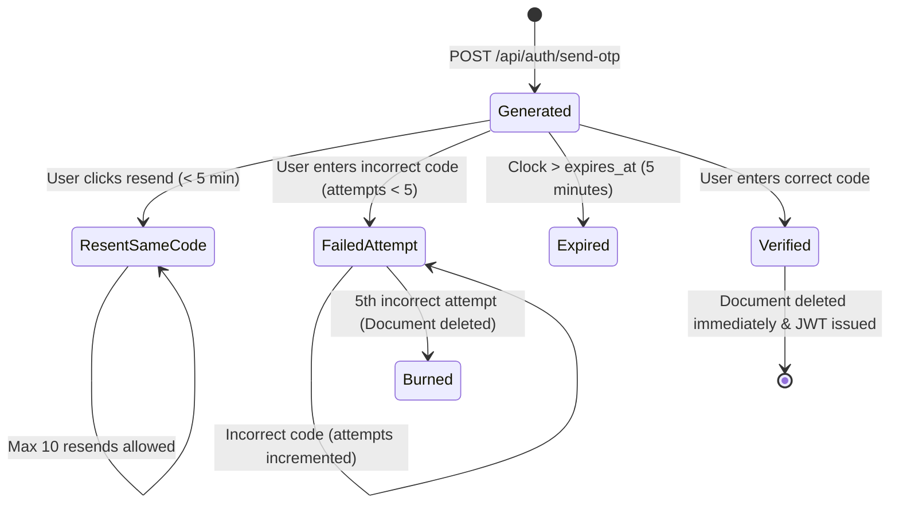

# Chapter 3: Phone Number Identity & Resilient OTP Systems

> *"A phone number is an anchor of physical identity in the digital world. Protecting its verification requires defending against both network delays and brute-force adversaries."*

---

## 3.1 Why Phone Numbers as Primary Identifiers?

In desktop-first enterprise software, email addresses are the traditional user identifier. However, in modern mobile-first applications, social communities, and alumni networks (such as the United89 Alumni Club), **phone numbers** are the single most reliable primary identifier:
1. **Direct Reach**: Almost every alumnus carries a mobile phone with WhatsApp or SMS capabilities.
2. **Reduced Fake Accounts**: Unlike disposable email accounts that can be created in seconds by bots, obtaining a valid phone number requires a physical SIM card or carrier contract.
3. **Simplicity**: Users do not need to memorize passwords that can be forgotten or reused across compromised sites.

However, using phone numbers introduces three major technical challenges:
- **Phone Number Format Entropy**: Users format phone numbers in wildly different ways.
- **SMS Gateway Latency & Race Conditions**: Telecom networks introduce arbitrary network jitter and delayed SMS delivery.
- **Financial & Brute-Force Vulnerabilities**: SMS dispatch costs real money, and 6-digit PINs have a finite mathematical search space.

---

## 3.2 The Phone Normalization Challenge

Consider how six different users might type the exact same phone number:
* `9437555900` (Raw 10 digits)
* `+91 94375 55900` (Country code with spaces)
* `+91-94375-55900` (Country code with hyphens)
* `+919437555900` (Country code without spaces)
* `(0) 94375 55900` (Trunk prefix with parentheses)
* `919437555900` (12 digits with prefix `91` but no `+`)

If a database stores each string verbatim, the same person will create **six different accounts** with six different score records!

### The Normalization Algorithm
Both our backend ([`quiz-app/backend/services/phone_service.py`](file:///Users/divyadarshee.das/Desktop/Pers/United89-club-app/quiz-app/backend/services/phone_service.py)) and frontend ([`quiz-app/frontend/src/utils/featureFlags.js`](file:///Users/divyadarshee.das/Desktop/Pers/United89-club-app/quiz-app/frontend/src/utils/featureFlags.js)) implement the exact same deterministic normalization pipeline:

#### Python Implementation (`phone_service.py`)
```python
def normalize_phone(phone: str) -> str:
    """
    Normalize phone number by removing country codes (+91), spaces, 
    dashes, parentheses, and keeping only clean digits.
    """
    if not phone:
        return ""
    # 1. Strip common formatting characters
    phone = phone.replace("+91", "").replace("-", "").replace(" ", "").replace("(", "").replace(")", "")
    # 2. Extract strictly digits
    phone = ''.join(filter(str.isdigit, phone))
    # 3. If number is 12 digits and starts with 91, strip the country code prefix
    if len(phone) > 10 and phone.startswith("91"):
        phone = phone[2:]
    return phone
```

#### JavaScript Implementation (`featureFlags.js`)
```javascript
export function normalizePhone(p) {
    if (!p) return '';
    let digits = String(p).replace(/\D/g, ''); // Strip all non-digit characters
    if (digits.length > 10 && digits.startsWith('91')) {
        digits = digits.slice(2);
    }
    return digits;
}
```

Now, whether an alumnus types `+91 94375 55900`, `(943) 755-5900`, or `919437555900`, the identifier resolves identically to:
$$\text{Clean Identifier} = \mathbf{9437555900}$$

---

## 3.3 The OTP Verification Lifecycle in Firestore

When a user requests an OTP, the backend creates a transient document inside Google Cloud Firestore in the collection `otp_verifications/{normalized_phone}`:

```json
{
  "phone": "+91 94375 55900",
  "normalized_phone": "9437555900",
  "code": "481920",
  "expires_at": "2026-11-03T08:15:00Z",
  "attempts": 0,
  "resend_count": 0,
  "created_at": "2026-11-03T08:10:00Z"
}
```



---

## 3.4 The "Same-OTP" Anti-Race Condition Pattern

One of the most frustrating user experiences on the modern web is the **SMS Race Condition**.

### The Classic Flawed Implementation
1. User clicks **"Send OTP"** at 10:00:00 AM.
2. The server generates Code $A$ (`111111`) and sends it to the SMS gateway.
3. Because of mobile network congestion, SMS $A$ is delayed by 30 seconds.
4. The user waits 15 seconds, gets impatient, and clicks **"Resend OTP"** at 10:00:15 AM.
5. The naive server generates Code $B$ (`222222`), overwriting the database.
6. At 10:00:30 AM, SMS $A$ (`111111`) finally arrives on the user's phone!
7. The user types `111111`.
8. The server rejects it as **Invalid OTP** because the database now expects Code $B$ (`222222`)!
9. Five seconds later, SMS $B$ arrives. The user is confused, frustrated, and locks themselves out.

### The Production Solution: The Same-OTP Pattern
Look at our implementation in [`quiz-app/backend/auth/otp.py`](file:///Users/divyadarshee.das/Desktop/Pers/United89-club-app/quiz-app/backend/auth/otp.py):

```python
# Check for existing unexpired OTP
if doc.exists:
    data = doc.to_dict()
    expires_at = data.get("expires_at")
    
    # If the code is still valid within its 5-minute lifetime
    if expires_at and now < expires_at:
        resend_count = data.get("resend_count", 0)
        
        # Rate limiting: Max 10 resends per 5-minute window
        if resend_count >= 10:
            raise HTTPException(
                status_code=429,
                detail="Too many resend attempts. Please wait for current code to expire."
            )
        
        # REUSE THE SAME ACTIVE CODE!
        existing_code = data.get("code")
        await otp_ref.update({
            "resend_count": resend_count + 1,
            "last_resend_at": now
        })
        
        # Dispatch SMS with the identical code
        await send_sms_otp(phone, existing_code)
        return existing_code, is_tester, True
```

**Why this is brilliant**:
- Whether SMS 1 or SMS 2 arrives first, **the code printed in both text messages is identical**!
- The user can type whichever SMS arrives on their screen, and authentication succeeds instantly.
- The original 5-minute expiration clock remains running, preventing infinite token extension.

---

## 3.5 Defending Against Attack Vectors

### 1. Brute-Force Search Space Defense (Max 5 Attempts)
A 6-digit PIN has $10^6 = 1,000,000$ possible combinations (from `000000` to `999999`).  
If an attacker writes a Python script sending 500 requests per second, they could guess the PIN in about 30 minutes!

To make brute force mathematically impossible:
```python
# quiz-app/backend/auth/otp.py
if attempts >= 5:
    await otp_ref.delete()
    raise HTTPException(
        status_code=400,
        detail="Too many incorrect attempts. This code has been invalidated. Please request a new one."
    )
```
* The probability of guessing a random 6-digit code in 5 attempts is:
  $$P(\text{Success}) = \frac{5}{1,000,000} = 0.0005\%$$
* An attacker has a **99.9995% chance of failing and burning the code**.

### 2. Single-Use Consumption (Replay Immunity)
Once an OTP is successfully verified, it must be incinerated:
```python
if stored_code == submitted_code:
    # One-time use: Delete document immediately upon success
    await otp_ref.delete()
    return True
```
If an eavesdropper intercepts the OTP packet after it was used, they cannot re-submit it because the document no longer exists in Firestore.

### 3. Financial Denial-of-Service Defense (HTTP 429)
SMS gateways charge per message sent (typically \$0.01 to \$0.05 per SMS). An attacker could write a script requesting an OTP for 100,000 phone numbers, exhausting thousands of dollars of club funds in minutes.

We enforce rate limits:
```python
if resend_count >= 10:
    raise HTTPException(
        status_code=429, # HTTP 429: Too Many Requests
        detail="Too many resend attempts. Please wait for the current code to expire."
    )
```

---

## 3.6 The Developer & Tester Bypass Strategy

During automated unit testing, end-to-end testing, or app store review, sending real SMS messages causes three problems:
1. It costs money for every automated test run.
2. Cell network delivery is asynchronous and takes 5–15 seconds, making tests slow and flaky.
3. Test runners cannot receive physical SMS text messages.

In [`quiz-app/backend/services/phone_service.py`](file:///Users/divyadarshee.das/Desktop/Pers/United89-club-app/quiz-app/backend/services/phone_service.py), we maintain a dynamic list of approved **Tester Phones** in Firestore configuration:

```python
async def is_tester_phone(phone: str) -> bool:
    tester_phones = await get_tester_phones_set()
    return normalize_phone(phone) in tester_phones
```

When a tester phone (e.g. `9437555900`) requests an OTP:
- The backend sets `code = "123456"`.
- It **bypasses external SMS dispatch**, saving money.
- The developer or test harness immediately enters `123456` and passes with zero network latency!

---

## 3.7 Summary of Key Concepts

1. **Phone normalization** strips arbitrary whitespace, dashes, and international prefixes (`+91`), ensuring deterministic database IDs.
2. The **Same-OTP Pattern** reuses active codes during the 5-minute validity window, eliminating SMS race conditions.
3. **Max 5 failed attempts** drops the mathematical brute-force probability to $0.0005\%$.
4. **Single-use deletion** ensures OTPs cannot be replayed.
5. **Tester bypasses** enable instantaneous, zero-cost automated unit testing and CI/CD pipelines.

---

## 🧠 Chapter 3 Review Questions

Try answering these questions yourself before consulting the [Appendix](07_APPENDIX_REVIEW_QUESTIONS_AND_ANSWERS.md)!

1. **Algorithm Tracing**: Given the raw input `"(+91) 94375-55900"`, trace the steps of `normalize_phone` to show its final normalized output. What would happen if this input was saved to a database without normalization?
2. **Race Condition Analysis**: Explain how a delayed SMS combined with an impatient user clicking "Resend" creates a race condition in naive OTP systems. How does the "Same-OTP" pattern solve this?
3. **Probability & Security**: An attacker builds a bot that attempts to guess 6-digit OTPs. If the system permits only 5 attempts before deleting the code, what is the exact probability that the attacker successfully breaks into an account on a given OTP cycle?
4. **API Economics**: Why is HTTP status code `429 Too Many Requests` crucial for SMS endpoints? What attack does it prevent?
