# Chapter 4: Firebase Authentication & Secure Token Exchange

> *"Outsource the complexity of identity providers to specialists; keep the governance of business roles within your own domain."*

---

## 4.1 The Role of Firebase in Modern Web Architectures

Building a custom OAuth2 integration with Google from scratch requires handling OAuth redirect URIs, state tokens, PKCE challenges, and token refreshes with Google's servers. Similarly, running an in-house telecom server requires managing carrier connections and SMS spam laws across 100+ countries.

Google's **Firebase Authentication** solves this by acting as a managed Identity-as-a-Service (IDaaS) provider:
1. **Google Sign-In**: Handles account selection, Google OAuth2 consent screens, 2-Factor Authentication, and passkeys.
2. **SMS Phone Auth**: Integrates invisible reCAPTCHA bot-checks and global SMS telecom carriers.

However, relying entirely on Firebase creates a dangerous trap: **Vendor Lock-in and Loss of Role Governance**.

---

## 4.2 The Token Exchange Pattern: The Best of Both Worlds

In our application, we implement the **Token Exchange Architecture**:

```mermaid
sequenceDiagram
    autonumber
    actor User as Member
    participant React as React Frontend (Vite)
    participant Google as Firebase Auth (Google)
    participant FastAPI as FastAPI Backend
    participant Firestore as Firestore Database

    User->>React: Clicks "Continue with Google"
    React->>Google: signInWithPopup(auth, googleProvider)
    Google-->>User: Prompts Google Sign-In & Consent
    User-->>Google: Approves Google Account
    Google-->>React: Returns Firebase UserCredential
    React->>Google: user.getIdToken()
    Google-->>React: Firebase ID Token (RS256 signed by Google)
    
    rect rgb(20, 30, 50)
    Note over React,FastAPI: Token Exchange Request
    React->>FastAPI: POST /api/auth/firebase-login { id_token, phone, name }
    FastAPI->>Google: firebase_admin.auth.verify_id_token(id_token)
    Google-->>FastAPI: Decoded claims { email, phone_number, sub }
    FastAPI->>Firestore: verify_or_bind_google_email(phone, token_email)
    FastAPI->>FastAPI: Assigns RBAC Role (9437555900 -> admin, else member)
    FastAPI->>FastAPI: Signs Custom Access Token (15m) + Refresh Token (15d)
    FastAPI-->>React: Returns { access_token, refresh_token, role, user_profile }
    end
```



### Why Exchange Tokens Instead of Using Firebase ID Tokens Everywhere?
1. **Application-Specific RBAC**: Google/Firebase does not know that phone number `9437555900` is the Grand Administrator of the United89 alumni club! Our backend governs roles.
2. **Ultra-Fast Local Verification**: Verifying a Google RS256 token requires downloading Google's public x509 certificates and parsing asymmetric cryptography. Verifying our custom `HS256` Access Token takes **0.0001 seconds** with zero external network requests!
3. **Decoupled Architecture**: If tomorrow we replace Firebase with Supabase, AWS Cognito, or an in-house SMS gateway, our entire API surface and database schemas remain completely unchanged!

---

## 4.3 Client-Side Firebase Implementation (React / Vite)

### 1. Initializing Firebase Auth
In [`quiz-app/frontend/src/firebase.js`](file:///Users/divyadarshee.das/Desktop/Pers/United89-club-app/quiz-app/frontend/src/firebase.js):

```javascript
import { initializeApp, getApps } from 'firebase/app';
import { getAuth, GoogleAuthProvider } from 'firebase/auth';

const firebaseConfig = {
    apiKey: import.meta.env.VITE_FIREBASE_API_KEY,
    authDomain: import.meta.env.VITE_FIREBASE_AUTH_DOMAIN,
    projectId: import.meta.env.VITE_FIREBASE_PROJECT_ID,
    appId: import.meta.env.VITE_FIREBASE_APP_ID,
};

// Singleton initialization pattern
const app = !getApps().length ? initializeApp(firebaseConfig) : getApps()[0];

export const auth = getAuth(app);
export const googleProvider = new GoogleAuthProvider();

// Force Google account chooser so users can pick their desired Gmail
googleProvider.setCustomParameters({ prompt: 'select_account' });
```

### 2. Triggering Google Sign-In & Capturing the ID Token
In `quiz-app/frontend/src/pages/Welcome.jsx`:

```javascript
import { signInWithPopup } from 'firebase/auth';
import { auth, googleProvider } from '../firebase';
import { loginWithFirebaseIdToken } from '../services/api';

const handleGoogleSignIn = async () => {
    try {
        // Step 1: Open Google OAuth popup
        const userCredential = await signInWithPopup(auth, googleProvider);
        
        // Step 2: Extract the cryptographically signed Firebase ID token
        const idToken = await userCredential.user.getIdToken();
        
        // Step 3: Exchange with FastAPI backend
        const response = await loginWithFirebaseIdToken({
            id_token: idToken,
            phone: phoneInput.trim(), // Linked WhatsApp number
            name: userCredential.user.displayName || nameInput.trim()
        });

        // Step 4: Save our custom JWTs into local AuthContext
        authLogin(response);
    } catch (error) {
        console.error("Google Sign-In Failed:", error);
    }
};
```

---

## 4.4 Backend Verification with Firebase Admin SDK

In [`quiz-app/backend/routers/auth.py`](file:///Users/divyadarshee.das/Desktop/Pers/United89-club-app/quiz-app/backend/routers/auth.py), the backend receives the `id_token` and executes rigorous cryptographic verification:

```python
import firebase_admin.auth
from fastapi import APIRouter, HTTPException
from schemas.auth import FirebaseLoginRequest
from services.phone_service import normalize_phone
from services.user_service import get_or_create_user, verify_or_bind_google_email
from auth.jwt import create_access_token, create_refresh_token

router = APIRouter(prefix="/api", tags=["Authentication"])

@router.post("/auth/firebase-login")
async def firebase_login(req: FirebaseLoginRequest):
    try:
        # Step 1: Cryptographically verify Google's signature, expiry, and audience
        decoded_token = firebase_admin.auth.verify_id_token(req.id_token)
        
        token_phone = decoded_token.get("phone_number")
        token_email = decoded_token.get("email")
        
        if token_phone:
            # Case 1: Authenticated directly via Firebase SMS OTP
            phone = token_phone
        elif token_email:
            # Case 2: Authenticated via Google Sign-In (linked to alumni phone)
            if not req.phone or not req.phone.strip():
                raise HTTPException(
                    status_code=400, 
                    detail="Phone number is required to link Google Sign-In."
                )
            phone = req.phone.strip()
            
            # Step 2: Crucial Identity Binding Check
            await verify_or_bind_google_email(phone, token_email)
        else:
            raise HTTPException(
                status_code=400, 
                detail="Neither phone_number nor email found in Firebase token."
            )
            
        # Step 3: Fetch or create user record in Firestore
        user_data, has_submitted, week_id = await get_or_create_user(
            phone, req.name, google_email=token_email
        )
        
        # Step 4: Resolve Role-Based Access Control (RBAC)
        norm_phone = normalize_phone(phone)
        role = "admin" if norm_phone == "9437555900" else "member"
        
        # Step 5: Issue our own custom dual JWT tokens
        access_token = create_access_token(user_id=phone, role=role)
        refresh_token = create_refresh_token(user_id=phone)
        
        return {
            "access_token": access_token,
            "refresh_token": refresh_token,
            "token_type": "bearer",
            "user_id": phone,
            "role": role,
            "admin_auth": (role == "admin"),
            "has_submitted": has_submitted,
            "week_id": week_id,
            "user": user_data
        }
    except firebase_admin.auth.InvalidIdTokenError:
        raise HTTPException(status_code=401, detail="Invalid Firebase ID token")
    except firebase_admin.auth.ExpiredIdTokenError:
        raise HTTPException(status_code=401, detail="Firebase token expired")
```

### What does `firebase_admin.auth.verify_id_token` check under the hood?
1. **Signature Verification**: Validates that the token was signed with Google's private key by downloading Google's rotating public certificates.
2. **Audience (`aud`) Check**: Validates that `aud == "gen-lang-client-0899905004"`, ensuring an ID token generated for a different app cannot be sent here.
3. **Issuer (`iss`) Check**: Validates that `iss == "https://securetoken.google.com/gen-lang-client-0899905004"`.
4. **Expiration (`exp`) Check**: Validates that the token has not expired.

---

## 4.5 The Account Binding Mechanism: Preventing Identity Hijacking

### The Threat Scenario
Suppose the application simply accepted any Google email and any phone number:
1. Attacker Charlie logs into his personal Google account `charlie@gmail.com`.
2. Charlie sends:
   ```json
   {
     "id_token": "<charlie_valid_google_token>",
     "phone": "9437555900" // The Administrator's Phone Number!
   }
   ```
3. If the backend naively checked that `id_token` is valid and granted access to `phone`, **Charlie would immediately hijack the Administrator's account!**

### The Defense: Secure Account Binding
Look at [`quiz-app/backend/services/user_service.py`](file:///Users/divyadarshee.das/Desktop/Pers/United89-club-app/quiz-app/backend/services/user_service.py):

```python
async def verify_or_bind_google_email(phone: str, google_email: str):
    """
    Ensures that a Google email is permanently bound to exactly one registered phone.
    Prevents unauthorized Google accounts from hijacking another member's phone record.
    """
    normalized = normalize_phone(phone)
    user_ref = db.collection("users").document(normalized)
    doc = await user_ref.get()
    
    if doc.exists:
        data = doc.to_dict()
        existing_email = data.get("google_email")
        
        # If this phone already has a bound Google Account:
        if existing_email:
            if existing_email.lower().strip() != google_email.lower().strip():
                raise HTTPException(
                    status_code=403,
                    detail=f"This phone number is permanently linked to {existing_email}. "
                           f"You cannot sign in with {google_email}."
                )
        else:
            # First Google login: Bind this email to the phone document
            await user_ref.update({"google_email": google_email.lower().strip()})
    else:
        # New user: will be saved with google_email during get_or_create_user
        pass
```

* **First Login (Binding)**: When an alumnus logs in with Google for the first time, their Google email address is recorded in their Firestore user document.
* **Subsequent Logins (Verification)**: If someone attempts to claim that phone number using a different Google email, the backend raises **`HTTP 403 Forbidden`**!
* **User Control**: The user can change or unlink their Gmail address at any time from their authenticated **Profile & Account** page.

---

## 4.6 Intelligent UI Fallback Experience

Network conditions in the field are unpredictable: Google OAuth servers can be unreachable on certain corporate VPNs, or SMS telecom gateways can face temporary outages.

In our UI ([`quiz-app/frontend/src/pages/Welcome.jsx`](file:///Users/divyadarshee.das/Desktop/Pers/United89-club-app/quiz-app/frontend/src/pages/Welcome.jsx)), we implement intelligent bi-directional fallbacks:
* If the user enters their phone number and SMS OTP fails:
  $$\text{Actionable Alert} \longrightarrow \mathbf{\text{"Continue with Google instead"}}$$
* If the user attempts Google Sign-In and encounters a network or account binding error:
  $$\text{Actionable Alert} \longrightarrow \mathbf{\text{"Verify via Phone SMS OTP instead"}}$$

The user is never trapped in a dead end.

---

## 4.7 Summary of Key Concepts

1. **Firebase Authentication** handles the frontend UI, OAuth2 popups, and carrier connectivity.
2. The **Token Exchange Pattern** trades external Firebase ID tokens for internal custom JWTs with application-specific RBAC.
3. `firebase_admin.auth.verify_id_token` performs cryptographic validation of Google's signatures, audience, and expiration.
4. **Account Binding** locks an alumnus's phone number to their verified Google email address, preventing account hijacking.
5. **Bi-directional Fallbacks** ensure members can always log in even during third-party service degradation.

---

## 🧠 Chapter 4 Review Questions

Try answering these questions yourself before consulting the [Appendix](07_APPENDIX_REVIEW_QUESTIONS_AND_ANSWERS.md)!

1. **Architecture Comparison**: Why does our application exchange the Firebase ID token for our own custom JWT instead of using the Firebase ID token for all subsequent API calls to `/api/quiz` and `/api/profile`? List three concrete advantages.
2. **Security Vulnerability**: Explain the Identity Hijacking vulnerability that arises if an application links a Google account to a phone number without the `verify_or_bind_google_email` check.
3. **Cryptographic Standards**: What signature algorithm does Google use to sign Firebase ID tokens (`RS256` vs `HS256`)? How does the backend obtain the key to verify it?
4. **Resilience**: If a user is on a company network that blocks Google OAuth2 popups, what fallback mechanism does our platform provide?
