# Chapter 6: FastAPI Layered Architecture & Microservice Blueprint
*(A Reusable Engineering Skill for Bootstrapping Production Python Backends)*

> *"Code is written once, but read, audited, and maintained a thousand times. Structure your applications so the architecture explains itself."*

---

## 6.1 The Spaghetti Anti-Pattern vs. Clean Layered Architecture

When novice engineers start building with FastAPI, they often write everything inside a single `main.py` file:

```python
# ❌ THE SPAGHETTI ANTI-PATTERN (Do NOT do this in production!)
from fastapi import FastAPI
app = FastAPI()

@app.post("/api/quiz/submit")
async def submit_quiz(user_id: str, answers: dict):
    # 1. Parsing raw dictionaries
    # 2. Directly querying Firestore database inline
    # 3. Computing mathematical scores inline
    # 4. Issuing JWT tokens inline
    # 5. Sending SMS notifications inline
    pass
```

### Why this anti-pattern fails in production:
1. **Zero Testability**: You cannot test score computation without having a live Firestore connection and SMS gateway running.
2. **Duplication**: If three endpoints need to verify phone numbers, the same 15 lines of string manipulation are copied in three places.
3. **Merge Conflict Chaos**: When five engineers work on different features, they all modify `main.py` simultaneously.

### The Solution: Layered Clean Architecture
In this architecture, responsibilities flow in a single direction from outer HTTP controllers down to foundational domain layers:

```mermaid
graph TD
    A["Clients / HTTP Requests"] --> B["routers/ (Controllers & Endpoints)"]
    B --> C["schemas/ (Pydantic DTOs & Validation)"]
    B --> D["services/ (Pure Business Logic & Orchestration)"]
    D --> E["core/ & auth/ (Database, Cryptography, Config)"]
    
    style B fill:#1e3a5f,stroke:#3b82f6,stroke-width:2px
    style C fill:#4a154b,stroke:#a855f7,stroke-width:2px
    style D fill:#1b4332,stroke:#10b981,stroke-width:2px
    style E fill:#432818,stroke:#f59e0b,stroke-width:2px
```



---

## 6.2 The Production Folder Structure Blueprint

Here is the exact production directory layout established in the **United89 Alumni Club Platform** (`quiz-app/backend/`):

```text
quiz-app/backend/
├── main.py                     # Entrypoint: FastAPI instantiation, CORS, router mounting
├── requirements.txt            # Python dependencies (fastapi, uvicorn, pydantic, pyjwt, etc.)
├── .env                        # Environment secrets (JWT keys, GCP credentials, ports)
│
├── core/                       # Foundational infrastructure & settings (Zero business logic)
│   ├── __init__.py
│   ├── config.py               # Robust dotenv parsing & path resolution
│   └── database.py             # Defensive async database client singleton (Firestore / SQL)
│
├── schemas/                    # Pydantic V2 Data Transfer Objects (DTOs) & input/output typing
│   ├── __init__.py
│   ├── auth.py                 # Login, OTP, and Token schemas
│   └── quiz.py                 # QuizConfig, SubmitAnswers, Question schemas
│
├── routers/                    # HTTP Controllers (Thin routers defining routes & status codes)
│   ├── __init__.py
│   ├── auth.py                 # /api/auth/send-otp, /api/auth/firebase-login, etc.
│   ├── quiz.py                 # /api/quiz/current, /api/quiz/submit, etc.
│   ├── admin.py                # /api/admin/quiz, /api/admin/submissions, etc.
│   └── config.py               # /api/config/quiz-settings
│
├── services/                   # Pure business logic & database queries (Framework-agnostic)
│   ├── __init__.py
│   ├── phone_service.py        # Normalization, tester identification, whitelisting
│   ├── user_service.py         # Profile fetching, Google account binding, user upsert
│   ├── sms_service.py          # Third-party telecom dispatch (Fast2SMS / Twilio)
│   └── quiz_service.py         # Scoring algorithms, week archives, winner calculations
│
├── auth/                       # Cryptographic primitives & authentication engines
│   ├── __init__.py
│   ├── jwt.py                  # Token encoding, decoding, expiration, type enforcement
│   └── otp.py                  # Same-OTP generation, attempt throttling, verification
│
└── tests/                      # Automated unit test suite (Fast, isolated, zero-dependency)
    ├── __init__.py
    ├── test_auth_jwt.py        # JWT creation, RBAC validation, expiration tests
    ├── test_phone_normalization.py # Format variations, edge-case stripping
    └── test_quiz_config.py     # Schema validation, dynamic question count scaling
```

---

## 6.3 Deep Dive into Each Layer

### Layer 1: `core/` (Configuration & Infrastructure)
`core/` holds the absolute foundation of your application: environment variables and database connections.

#### Robust Absolute Path Loading (`core/config.py`)
A common bug in Python occurs when running scripts or tests from different directories: `load_dotenv()` looks in the current working directory, which breaks when tests run from the project root!

In our implementation, we determine the absolute path of the backend directory dynamically:

```python
import os
from dotenv import load_dotenv

# BASE_DIR always points to quiz-app/backend/, regardless of where python is executed
BASE_DIR = os.path.dirname(os.path.dirname(os.path.abspath(__file__)))
load_dotenv(os.path.join(BASE_DIR, ".env"))

# Authentication & Cryptography Config
SECRET_KEY = os.getenv("JWT_SECRET_KEY", "fallback-secret-for-dev")
ALGORITHM = "HS256"
ACCESS_TOKEN_EXPIRE_MINUTES = int(os.getenv("ACCESS_TOKEN_EXPIRE_MINUTES", "15"))
REFRESH_TOKEN_EXPIRE_DAYS = int(os.getenv("REFRESH_TOKEN_EXPIRE_DAYS", "15"))

# Database & Credentials Path Resolution
GOOGLE_APPLICATION_CREDENTIALS = os.getenv("GOOGLE_APPLICATION_CREDENTIALS")
if GOOGLE_APPLICATION_CREDENTIALS and not os.path.isabs(GOOGLE_APPLICATION_CREDENTIALS):
    abs_path = os.path.join(BASE_DIR, GOOGLE_APPLICATION_CREDENTIALS.lstrip("./"))
    if os.path.exists(abs_path):
        os.environ["GOOGLE_APPLICATION_CREDENTIALS"] = abs_path
```

#### Defensive Database Client (`core/database.py`)
Never let a database connection failure crash the entire module import! In unit test environments or CI runners without cloud credentials, wrapping client creation in `try/except` ensures tests can run cleanly:

```python
import firebase_admin
from firebase_admin import credentials, firestore
from core.config import GOOGLE_APPLICATION_CREDENTIALS, DB_NAME

try:
    if not firebase_admin._apps:
        if GOOGLE_APPLICATION_CREDENTIALS and os.path.exists(GOOGLE_APPLICATION_CREDENTIALS):
            cred = credentials.Certificate(GOOGLE_APPLICATION_CREDENTIALS)
            firebase_admin.initialize_app(cred)
        else:
            firebase_admin.initialize_app()
except Exception as e:
    print(f"Warning: Failed to initialize Firebase Admin: {e}")

# Async Firestore Client with Graceful Fallback
try:
    db = firestore.AsyncClient(database=DB_NAME)
except Exception as e:
    print(f"Warning: Failed to initialize firestore.AsyncClient: {e}")
    db = None
```

---

### Layer 2: `schemas/` (Pydantic V2 DTOs)
Schemas define the shape of data coming into and going out of your API. They guarantee that invalid data is rejected **before** it touches your business logic.

```python
# quiz-app/backend/schemas/quiz.py
from pydantic import BaseModel, Field
from typing import Optional, Dict

class QuizConfig(BaseModel):
    timer_duration_minutes: int = 10
    question_count: Optional[int] = 10     # Dynamic question count scaling
    quiz_active: bool = False
    leaderboard_active: bool = False
    answers_visible: bool = False
    active_theme: str = "default"

class SubmitAnswers(BaseModel):
    user_id: str
    week_id: str
    answers: Dict[str, str]                # Dynamically accepts q_1 to q_20
    time_taken: int
```

* **Self-Documenting**: FastAPI automatically inspects these Pydantic models to generate interactive OpenAPI / Swagger documentation at `/docs`.
* **Validation**: If a user submits `"timer_duration_minutes": "invalid_string"`, Pydantic immediately returns `HTTP 422 Unprocessable Entity` with a detailed error trace.

---

### Layer 3: `routers/` (Thin Controllers)
A router should only do three things:
1. Parse and validate the incoming request (via Pydantic).
2. Call the appropriate function in `services/`.
3. Return the response model with the proper HTTP status code.

```python
# quiz-app/backend/routers/config.py
from fastapi import APIRouter, HTTPException
from schemas.quiz import QuizConfig
from core.database import db

router = APIRouter(prefix="/api/config", tags=["Configuration"])

@router.get("/quiz-settings", response_model=QuizConfig)
async def get_quiz_config():
    doc = await db.collection("config").document("quiz_settings").get()
    if not doc.exists:
        return QuizConfig() # Return default schema values
    return QuizConfig(**doc.to_dict())
```

---

### Layer 4: `services/` (Pure Domain Business Logic)
Functions in `services/` are pure Python functions that contain your business calculations, data transformations, and database queries. They do not know or care about HTTP headers, status codes, or FastAPI dependencies.

**Why this separation is vital**:
If you later write an automated CLI tool, a background cron job, or a test script, you can call `normalize_phone("+91 94375 55900")` or `calculate_score(answers)` directly without simulating an HTTP request!

---

### Layer 5: `tests/` (Automated Unit Testing)
Automated testing ensures changes made today do not break features built yesterday. By using Python's standard `unittest` library, tests execute in milliseconds with zero extra dependencies:

```python
# quiz-app/backend/tests/test_quiz_config.py
import unittest
from schemas.quiz import QuizConfig

class TestQuizConfig(unittest.TestCase):
    def test_dynamic_question_scaling(self):
        """Verifies that changing question_count scales from 10 to 20 cleanly"""
        config = QuizConfig(question_count=20, timer_duration_minutes=15)
        self.assertEqual(config.question_count, 20)
        self.assertEqual(config.timer_duration_minutes, 15)

if __name__ == '__main__':
    unittest.main()
```

To run all backend unit tests:
```bash
python3 -m unittest discover -s tests -p "test_*.py"
```

---

## 6.4 The 5-Minute FastAPI Project Quickstart Recipe (Skill)

Whenever you start a brand-new FastAPI project in the future, follow this rapid checklist:

1. **Bootstrap Folder Structure**:
   ```bash
   mkdir -p my_app/{core,schemas,routers,services,auth,tests}
   touch my_app/{main.py,requirements.txt,.env}
   touch my_app/{core,schemas,routers,services,auth,tests}/__init__.py
   ```
2. **Install Core Dependencies**:
   ```bash
   pip install fastapi uvicorn pydantic python-dotenv pyjwt
   ```
3. **Configure `core/config.py`**:
   Set up dynamic `BASE_DIR` and `load_dotenv()` with default fallbacks.
4. **Define Schemas First (`schemas/`)**:
   Model your request payloads and response shapes using Pydantic `BaseModel`.
5. **Implement Services (`services/` & `auth/`)**:
   Write the core business algorithms and data operations as pure functions.
6. **Mount Routers in `main.py`**:
   Use `app.include_router(auth.router)` and enable CORS middleware.
7. **Write Unit Tests First (`tests/`)**:
   Add unit tests verifying your business logic and schemas.

---

## 6.5 Summary of Key Concepts

1. **Clean Layered Architecture** separates concerns between Routing (`routers/`), Validation (`schemas/`), Domain Logic (`services/`), and Infrastructure (`core/`).
2. **Dynamic `BASE_DIR`** prevents path resolution errors when running tests or servers from arbitrary working directories.
3. **Defensive database client initialization** allows test runners to execute offline without cloud credentials.
4. **Pydantic V2 schemas** provide automated type validation and auto-generate OpenAPI documentation.
5. **Pure service functions** make testing effortless and decouple business logic from the HTTP transport layer.

---

## 🧠 Chapter 6 Review Questions

Try answering these questions yourself before consulting the [Appendix](07_APPENDIX_REVIEW_QUESTIONS_AND_ANSWERS.md)!

1. **Architectural Separation**: Explain why database queries and score calculation algorithms should be placed inside `services/` rather than directly inside endpoint functions in `routers/`.
2. **Path Resolution Problem**: What problem occurs if a Python script uses `load_dotenv()` without specifying an absolute path, and the script is executed from a parent or sibling directory? How does `BASE_DIR = os.path.dirname(os.path.dirname(os.path.abspath(__file__)))` solve it?
3. **Defensive Infrastructure**: Why is it beneficial to wrap database client initialization (`firestore.AsyncClient(...)`) in a `try/except` block that defaults to `None`? What happens to unit tests if you don't?
4. **Pydantic V2**: How does defining a schema like `class QuizConfig(BaseModel): question_count: int = 10` protect your database from corrupted or malformed data?
