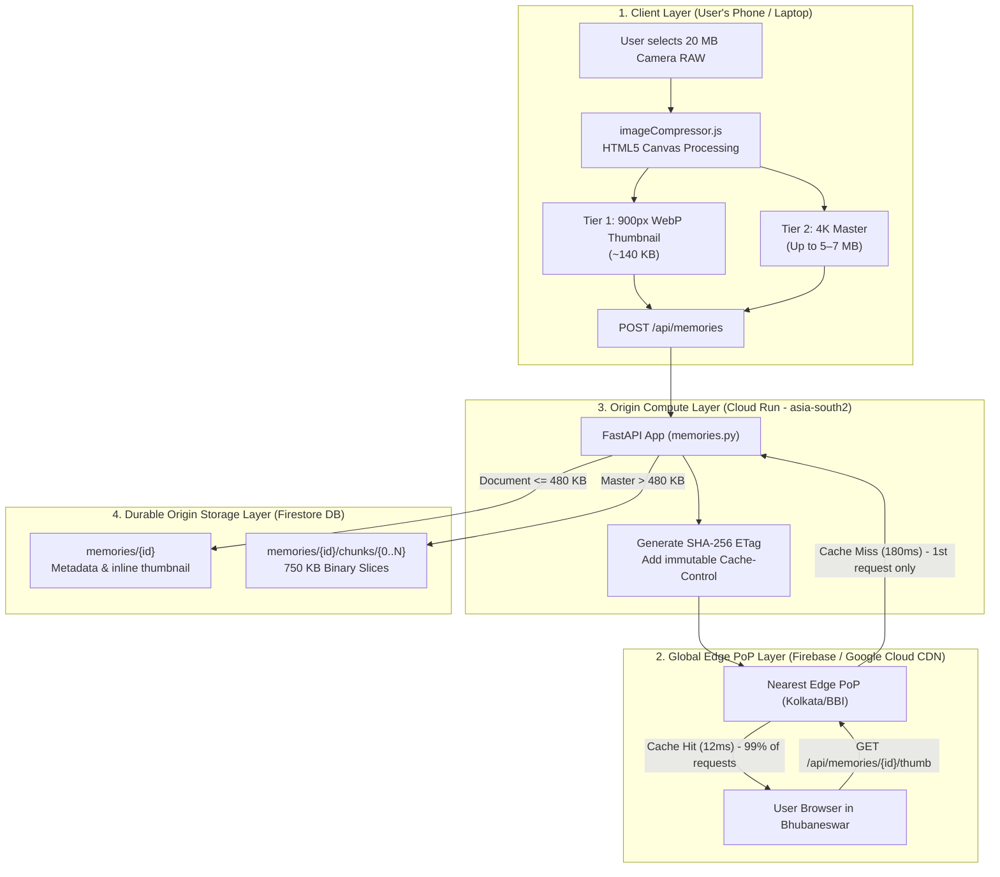

# CDN & Media System Design Course

> **A production-grounded masterclass on building lightning-fast, globally distributed media architectures.**  
> Using real-world code from the [United89 Club App (`Yaadein • यादें`)](file:///Users/divyadarshee.das/Desktop/Pers/United89-club-app/quiz-app/frontend/src/pages/Yaadein.jsx).

---

## Welcome to the Course!

Have you ever wondered how apps like **Instagram**, **Netflix**, **Google Photos**, or our very own **United89 Yaadein Club Gallery** can display hundreds of crystal-clear photos and videos in the blink of an eye—without your phone freezing or your battery draining?

If you are a beginner, the world of CDNs (Content Delivery Networks), edge caching, HTTP headers, and blob storage can feel like a maze of buzzwords. You might hear engineers talk about *LRU eviction*, *304 Not Modified*, *Points of Presence*, *ETags*, and *Byte Chunking*, and wonder:
- *What do these actually mean?*
- *Why can't I just save a photo in my database like I save a user's name?*
- *Does a CDN keep copies of everything in the world forever?*

This course was built to answer those questions from the ground up. **No prior networking or distributed systems knowledge is assumed.** We will explain every single concept using vivid, real-world analogies—like neighborhood grocery stores, postal zip codes, library return desks, and closet storage. 

Then, we bridge theory directly to **battle-tested production code** inside this repository:
- Frontend Gallery & Lightbox: [`quiz-app/frontend/src/pages/Yaadein.jsx`](file:///Users/divyadarshee.das/Desktop/Pers/United89-club-app/quiz-app/frontend/src/pages/Yaadein.jsx)
- In-Browser Image Processor: [`quiz-app/frontend/src/utils/imageCompressor.js`](file:///Users/divyadarshee.das/Desktop/Pers/United89-club-app/quiz-app/frontend/src/utils/imageCompressor.js)
- Cloud Run Streaming & Caching API: [`quiz-app/backend/routers/memories.py`](file:///Users/divyadarshee.das/Desktop/Pers/United89-club-app/quiz-app/backend/routers/memories.py)
- Edge CDN Infrastructure Rules: [`quiz-app/firebase.json`](file:///Users/divyadarshee.das/Desktop/Pers/United89-club-app/quiz-app/firebase.json)

---

## Complete 15-Chapter Curriculum

| Chapter | Title & Focus Area | Key Repository File Examined |
| :--- | :--- | :--- |
| [**01**](file:///Users/divyadarshee.das/Desktop/Pers/United89-club-app/docs/cdn-system-design-course/01-the-problem-why-media-is-hard.md) | **The Problem: Why Media is Hard** Bandwidth, latency, speed-of-light limits, and why sending 50 photos is 10,000× heavier than sending JSON. | [Yaadein.jsx](file:///Users/divyadarshee.das/Desktop/Pers/United89-club-app/quiz-app/frontend/src/pages/Yaadein.jsx) |
| [**02**](file:///Users/divyadarshee.das/Desktop/Pers/United89-club-app/docs/cdn-system-design-course/02-what-is-a-cdn-and-edge-pops.md) | **What is a CDN and Edge PoPs?** The "Central Warehouse vs. Neighborhood Grocery Store" analogy, Anycast routing, and Edge Points of Presence. | [firebase.json](file:///Users/divyadarshee.das/Desktop/Pers/United89-club-app/quiz-app/firebase.json) |
| [**03**](file:///Users/divyadarshee.das/Desktop/Pers/United89-club-app/docs/cdn-system-design-course/03-pull-vs-push-cdns-and-read-through-caching.md) | **Pull vs. Push CDNs & Read-Through Caching** How Pull CDNs handle the 1st request (Cache Miss) vs. the 2nd–1,000th request (Cache Hit). | [firebase.json](file:///Users/divyadarshee.das/Desktop/Pers/United89-club-app/quiz-app/firebase.json) & [memories.py](file:///Users/divyadarshee.das/Desktop/Pers/United89-club-app/quiz-app/backend/routers/memories.py) |
| [**04**](file:///Users/divyadarshee.das/Desktop/Pers/United89-club-app/docs/cdn-system-design-course/04-lru-cache-and-eviction-deep-dive.md) | **LRU Cache & Eviction Deep Dive** Does a CDN store everything? How RAM/NVMe SSD limits force LRU, LFU, and TTL evictions at the edge. | [memories.py](file:///Users/divyadarshee.das/Desktop/Pers/United89-club-app/quiz-app/backend/routers/memories.py) |
| [**05**](file:///Users/divyadarshee.das/Desktop/Pers/United89-club-app/docs/cdn-system-design-course/05-http-caching-headers-explained.md) | **HTTP Caching Headers Explained** `public`, `max-age`, `s-maxage`, `immutable`, `no-cache`, and `no-store` decoded for browsers and CDN proxies. | [firebase.json](file:///Users/divyadarshee.das/Desktop/Pers/United89-club-app/quiz-app/firebase.json) & [memories.py](file:///Users/divyadarshee.das/Desktop/Pers/United89-club-app/quiz-app/backend/routers/memories.py) |
| [**06**](file:///Users/divyadarshee.das/Desktop/Pers/United89-club-app/docs/cdn-system-design-course/06-etags-hashing-and-304-not-modified.md) | **ETags, Hashing, & 304 Not Modified** How cryptographic fingerprints and `If-None-Match` save 100% of bandwidth during revalidation. | [memories.py](file:///Users/divyadarshee.das/Desktop/Pers/United89-club-app/quiz-app/backend/routers/memories.py) |
| [**07**](file:///Users/divyadarshee.das/Desktop/Pers/United89-club-app/docs/cdn-system-design-course/07-cache-invalidation-and-immutable-urls.md) | **Cache Invalidation & Immutable URLs** Why cache invalidation is notoriously hard, and why Content-Addressed & Unique URLs eliminate the problem. | [memories.py](file:///Users/divyadarshee.das/Desktop/Pers/United89-club-app/quiz-app/backend/routers/memories.py) |
| [**08**](file:///Users/divyadarshee.das/Desktop/Pers/United89-club-app/docs/cdn-system-design-course/08-separating-metadata-db-from-blob-storage.md) | **Separating Metadata DB from Blob Storage** Why returning multi-megabyte base64 strings in list APIs is a catastrophe, with back-of-the-envelope math. | [memories.py](file:///Users/divyadarshee.das/Desktop/Pers/United89-club-app/quiz-app/backend/routers/memories.py) |
| [**09**](file:///Users/divyadarshee.das/Desktop/Pers/United89-club-app/docs/cdn-system-design-course/09-the-5mb-to-7mb-high-res-problem-dual-tier-images.md) | **The 5–7 MB High-Res Problem: Dual-Tier Architecture** Why loading 50 raw 4K photos crashes mobile RAM, and how 150 KB Thumbnails + 5–7 MB Masters solve it. | [imageCompressor.js](file:///Users/divyadarshee.das/Desktop/Pers/United89-club-app/quiz-app/frontend/src/utils/imageCompressor.js) & [Yaadein.jsx](file:///Users/divyadarshee.das/Desktop/Pers/United89-club-app/quiz-app/frontend/src/pages/Yaadein.jsx) |
| [**10**](file:///Users/divyadarshee.das/Desktop/Pers/United89-club-app/docs/cdn-system-design-course/10-bypassing-database-limits-chunked-blobs-vs-object-storage.md) | **Bypassing DB Limits: Chunked Blobs vs. Object Storage** Firestore's 1 MiB limit, S3/GCS buckets, and our 750 KB binary chunk subcollection engine. | [memories.py](file:///Users/divyadarshee.das/Desktop/Pers/United89-club-app/quiz-app/backend/routers/memories.py) |
| [**11**](file:///Users/divyadarshee.das/Desktop/Pers/United89-club-app/docs/cdn-system-design-course/11-client-side-image-processing-pipeline.md) | **Client-Side Image Processing Pipeline** Line-by-line breakdown of HTML5 Canvas scaling, aspect-ratio math, quality decay loops, and WebP encoding. | [imageCompressor.js](file:///Users/divyadarshee.das/Desktop/Pers/United89-club-app/quiz-app/frontend/src/utils/imageCompressor.js) |
| [**12**](file:///Users/divyadarshee.das/Desktop/Pers/United89-club-app/docs/cdn-system-design-course/12-backend-cdn-endpoints-code-walkthrough.md) | **Backend CDN Endpoints Code Walkthrough** Line-by-line tour of FastAPI endpoints, streaming chunks, ETag generation, and conditional responses. | [memories.py](file:///Users/divyadarshee.das/Desktop/Pers/United89-club-app/quiz-app/backend/routers/memories.py) |
| [**13**](file:///Users/divyadarshee.das/Desktop/Pers/United89-club-app/docs/cdn-system-design-course/13-moderation-state-machine-and-rbac-security.md) | **Moderation State Machine & RBAC Security** Pending-to-Approved lifecycles, Admin phone normalization, and role-based isolation of sensitive media. | [memories.py](file:///Users/divyadarshee.das/Desktop/Pers/United89-club-app/quiz-app/backend/routers/memories.py) & [Yaadein.jsx](file:///Users/divyadarshee.das/Desktop/Pers/United89-club-app/quiz-app/frontend/src/pages/Yaadein.jsx) |
| [**14**](file:///Users/divyadarshee.das/Desktop/Pers/United89-club-app/docs/cdn-system-design-course/14-frontend-performance-lazy-loading-and-lcp.md) | **Frontend Performance: Lazy Loading, CSS Columns & LCP** Optimizing Core Web Vitals with `loading="lazy"`, `decoding="async"`, and zero-dependency CSS masonry. | [Yaadein.jsx](file:///Users/divyadarshee.das/Desktop/Pers/United89-club-app/quiz-app/frontend/src/pages/Yaadein.jsx) |
| [**15**](file:///Users/divyadarshee.das/Desktop/Pers/United89-club-app/docs/cdn-system-design-course/15-system-design-interview-cheat-sheet.md) | **System Design Interview Cheat Sheet** Numbers every engineer must know, quick-fire Q&A, and trade-off matrices for senior engineering interviews. | *Comprehensive Review* |

---

## End-to-End Architecture Overview

Here is how all the pieces of the Yaadein media pipeline connect across the globe:

---

## Recommended Learning Pathways

### Track 1: Complete Beginner to Web & Systems (Chapters 1 $\to$ 7)
If you are new to web development, networking, or how the Internet works:
1. Start with **Chapter 01** to understand why photos take so much more work than simple text.
2. Read **Chapters 02 & 03** to discover how CDN Edge servers act as neighborhood stores.
3. Master **Chapters 04, 05, 06, and 07** to understand the universal mechanics of web caching, headers, and hashes.

### Track 2: Full-Stack & Frontend Engineer (Chapters 8 $\to$ 14)
If you build React, Vue, Next.js, or mobile applications and want to stop crashes, slow page loads, and costly cloud bills:
1. Read **Chapter 08** to see why inline base64 strings ruin API performance.
2. Read **Chapter 09** for the Dual-Tier thumbnail/master design pattern.
3. Study **Chapter 11** for an in-depth walkthrough of client-side canvas processing.
4. Study **Chapter 14** to master Core Web Vitals (LCP, CLS) and native CSS masonry.

### Track 3: Senior System Design Interview Preparation (All Chapters + 15)
If you are preparing for System Design interviews at top tech companies (Meta, Google, Amazon, Uber):
1. Pay special attention to the **Back-of-the-Envelope Math** in Chapter 08.
2. Review the **Edge LRU Eviction & Multi-tier Caching** in Chapter 04.
3. Study the **Database Limits vs. Blob Storage trade-offs** in Chapter 10.
4. Finish with the **Interview Cheat Sheet and Trade-Off Matrices** in Chapter 15.

---

## Glossary of Fundamental Terms

- **Origin Server:** The authoritative, permanent "home" of your application and database (e.g. our Cloud Run backend in `asia-south2`).
- **Edge PoP (Point of Presence):** A localized data center placed directly inside an Internet Service Provider (ISP) or major city hub to serve content physically close to users.
- **Cache Hit:** When a requested file is already waiting in the Edge server's memory, returning it instantly without disturbing the Origin.
- **Cache Miss:** When the Edge does not have the requested file, forcing it to fetch the file from the Origin, store a copy, and forward it to the user.
- **TTL (Time-To-Live):** The lifespan of a cached item before it is considered stale.
- **LRU (Least Recently Used):** An eviction algorithm that discards the oldest unread items when memory runs out.
- **ETag (Entity Tag):** A unique cryptographic checksum (fingerprint) of a file used to verify whether the file has changed.
- **304 Not Modified:** An HTTP response confirming the client already has the latest file, transmitting 0 bytes of file body.
- **LCP (Largest Contentful Paint):** A Core Web Vital measuring how quickly the largest visible element (usually an image) finishes rendering on screen.
- **Dual-Tier Media:** Generating a lightweight version for lists/grids and a master high-resolution version for full-screen inspection.

Let's begin our journey with [**Chapter 01: The Problem — Why Media is Hard**](file:///Users/divyadarshee.das/Desktop/Pers/United89-club-app/docs/cdn-system-design-course/01-the-problem-why-media-is-hard.md)!
