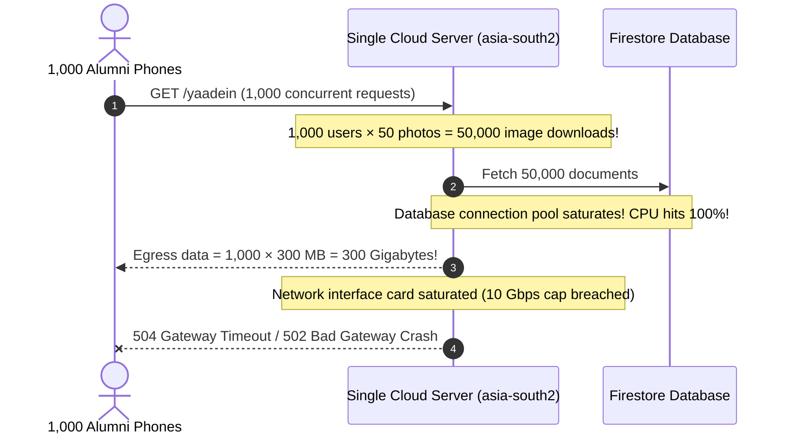

# Chapter 01: The Problem — Why Media is Hard

> *"In theory, there is no difference between theory and practice. In practice, there is."*  
> — Benjamin Brewster

---

## 1. The Postcard vs. 50 Grand Pianos

When developers first learn web development, they build apps that deal with **text and numbers**:
- A user table with names, email addresses, and phone numbers.
- A list of blog posts or quiz questions.
- A shopping cart containing item IDs and prices.

In the world of computers, text is featherweight. An entire user profile containing a name, college batch year, phone number, and bio fits inside **500 bytes** of JSON:

```json
{
  "id": "user-8901",
  "name": "Pradeep Mohanty",
  "batch": "1987-1989",
  "branch": "Electrical Engineering",
  "city": "Bhubaneswar",
  "bio": "Proud UCE Burla alumnus. Love badminton and photography."
}
```

Transmitting this JSON record across the Internet is like mailing a **paper postcard**. It is tiny, slips effortlessly into any postal bag, costs almost nothing to ship, and arrives immediately. If 1,000 alumni request this JSON at the same time, your server barely breaks a sweat—the total data transferred is just $1,000 \times 500\text{ bytes} = 500\text{ KB}$ (half a single megabyte!).

### Now, Introduce Media

Imagine our club members attend the 35th Annual Reunion in Burla. They take out their modern smartphones—an iPhone 15 Pro, a Samsung Galaxy S24, or a Google Pixel. Each phone packs a 48-to-200 megapixel camera sensor. When they snap a photo of the batch sitting by the Mahanadi river, that single photo file is **6 megabytes to 15 megabytes**.

Now, suppose you build a photo gallery page like [Yaadein.jsx](file:///Users/divyadarshee.das/Desktop/Pers/United89-club-app/quiz-app/frontend/src/pages/Yaadein.jsx) and display **50 batch photos** on the screen.

```
Text Request: 50 JSON records   =     25 Kilobytes (0.025 MB)
Photo Request: 50 Camera photos = 300,000 Kilobytes (300.000 MB)
```

**That is a 12,000× difference in weight!**

Serving 50 high-resolution photos is no longer like sending postcards through the mail. It is like hiring a fleet of 50 semi-trucks to transport **50 concert grand pianos across the country simultaneously**. 

If the highway is congested, the trucks grind to a halt. If a bridge is narrow, they get backed up for miles. And if your receiving dock (the user's smartphone) isn't large enough to park 50 grand pianos, **the entire system crashes**.

---

## 2. The Three Inescapable Laws of the Physical World

Why can't we just buy a faster server or more bandwidth and ignore the problem? Because media architectures run head-first into three immovable laws of physics and hardware.

```
                    ┌─────────────────────────────────────────┐
                    │    The 3 Inescapable Physical Limits    │
                    └────────────────────┬────────────────────┘
                                         │
         ┌───────────────────────────────┼───────────────────────────────┐
         ▼                               ▼                               ▼
┌─────────────────┐             ┌─────────────────┐             ┌─────────────────┐
│   1. Latency    │             │  2. Bandwidth   │             │   3. Client     │
│ (Speed of Light)│             │ (Pipe Capacity) │             │  Device Memory  │
└─────────────────┘             └─────────────────┘             └─────────────────┘
```

---

### Limit 1: The Speed of Light in Fiber Glass

You cannot beat Albert Einstein.

Information on the Internet travels through fiber optic cables as pulses of light. While light in a vacuum travels at $300,000\text{ km/s}$, inside the silica glass of fiber optic cables, light slows down by about 31% to roughly:

$$v_{\text{fiber}} \approx 200,000\text{ km/s} \quad (200\text{ km per millisecond})$$

Suppose your central backend origin server is deployed in Frankfurt, Germany or California, and an alumnus named Debashis is sitting in **Bhubaneswar, India**, opening the Yaadein album on his phone.

```
Debashis (Bhubaneswar, India) <═════ 7,500 km of cable ═════> Origin Server (Frankfurt)
```

1. His phone sends a request packet: $7,500\text{ km} \div 200\text{ km/ms} = 37.5\text{ ms}$.
2. The server processes the request and sends the first packet back: another $37.5\text{ ms}$.
3. In pure physics alone, the **Round Trip Time (RTT)** is $75\text{ ms}$—before accounting for router hops, switches, and TCP handshakes! In real-world networking, an India-to-Europe round trip easily takes **160ms to 240ms**.

Now consider how TCP (the protocol powering HTTP) transfers files:
- It does **not** blast a 6 MB image in one instant firehose.
- It starts with a tiny handful of packets (the **TCP Slow Start** algorithm).
- It waits for an acknowledgment (ACK) from the client: *"Did you get that?"*
- Once confirmed, it doubles the window and sends more packets.

For a 6 MB photo, this back-and-forth negotiation takes **dozens of round trips**. If each round trip takes 200ms, downloading a single photo over a long-distance connection takes **4 to 8 seconds**. Multiply that by 50 photos, and your user is staring at a blank screen for two minutes!

---

### Limit 2: Bandwidth is a Pipe, Not an Ocean

Bandwidth is often confused with speed. Think of bandwidth as the **width of a water pipe**, while latency is the **time it takes for the water to travel from the reservoir to your faucet**.

```
High Latency, High Bandwidth:
A massive 10-foot-wide pipeline, but it runs all the way from the Himalayas.
(Tons of data can arrive, but the first drop takes a long time).

Low Latency, Low Bandwidth:
A drinking straw connected to a water cooler sitting right on your desk.
(Water arrives in 1 millisecond, but you can only sip 1 drop at a time).
```

When users are on mobile 4G or 5G connections:
- Signals bounce off concrete buildings.
- As the user walks or drives, cell towers hand over the connection.
- Packet loss occurs. When TCP detects a lost packet, it abruptly **slashes throughput by 50%** to prevent network collapse.
- If an app tries to pull 300 MB of uncompressed image data over a flaky mobile pipe, the connection stalls, socket timeouts trigger, and photos display broken image icons.

---

### Limit 3: Mobile RAM & The GPU Texture Explosion

This is the silent killer that catches 95% of junior engineers off guard.

When you download a **compressed** JPEG or WebP image from the internet, it might be 3 MB on disk. But a smartphone screen cannot display a compressed JPEG directly! The phone's operating system (iOS or Android) must **decompress** that image into raw pixel values before sending it to the graphics card (GPU).

Let's do the math for an uncompressed 12-megapixel photo ($4000 \times 3000\text{ pixels}$):

$$\text{Total Pixels} = 4000 \times 3000 = 12,000,000\text{ pixels}$$

Each pixel requires 4 bytes of memory for Red, Green, Blue, and Alpha (transparency):

$$\text{Memory} = 12,000,000 \times 4\text{ bytes} = 48,000,000\text{ bytes} \approx 48\text{ Megabytes of RAM!}$$

> [!WARNING]
> Even though the file was only 3 MB on your server, **it takes 48 MB of active RAM inside the mobile browser** to render!

If your gallery displays 50 high-res photos:

$$50 \times 48\text{ MB} = \mathbf{2,400\text{ MB (2.4 Gigabytes of RAM!)}}$$

What happens when Mobile Safari on an iPhone or Chrome on an Android phone realizes that a single browser tab is consuming 2.4 GB of system memory?  
**The operating system kills the tab instantly.** The user sees a white screen or the dreaded *"This webpage was reloaded because a problem occurred."*

---

## 3. The "Reunion Night" Scale Nightmare

Let's see what happens to your backend server during a real event.

It is 8:30 PM on the night of the UCE '87 Golden Jubilee Dinner. The master of ceremonies announces:  
*"Everyone, open the Yaadein tab on your phones! We just uploaded the group photos from this afternoon!"*

**1,000 alumni simultaneously take out their phones and tap the link.**



### The Disaster Numbers:
1. **Network Egress:** $1,000\text{ users} \times 300\text{ MB} = \mathbf{300\text{ Gigabytes}}$ of data bursting out in under 60 seconds. That requires an outbound network pipe of:
   $$\frac{300\text{ GB} \times 8\text{ bits}}{60\text{ seconds}} = \mathbf{40\text{ Gigabits per second (Gbps)}}$$
   A standard Cloud Run container or virtual machine typically tops out at 1 Gbps to 2 Gbps. Your server interface simply drops connections.
2. **Cloud Egress Bills:** Cloud providers charge between \$0.08 and \$0.12 per Gigabyte of outbound data leaving their data centers. A single night of heavy traffic could cost hundreds of dollars for a small club app!
3. **Database Concurrency:** If the images are stored directly in your database, 50,000 simultaneous reads will exhaust your database connection pool, causing the entire quiz and membership app to crash alongside the photo album.

---

## 4. How Yaadein Solves This

In our repository, we tackled these physical constraints through a cohesive, multi-layered architecture:

1. **Edge CDN Distribution:** We never make users in Bhubaneswar or Singapore cross oceans to fetch binary assets. We serve them from edge nodes located in their city via [`quiz-app/firebase.json`](file:///Users/divyadarshee.das/Desktop/Pers/United89-club-app/quiz-app/firebase.json).
2. **Dual-Tier Image Generation:** In [`quiz-app/frontend/src/utils/imageCompressor.js`](file:///Users/divyadarshee.das/Desktop/Pers/United89-club-app/quiz-app/frontend/src/utils/imageCompressor.js), we never load the 6 MB master on the gallery grid. We generate a featherweight **~140 KB WebP thumbnail** specifically for the masonry scroll!
3. **Lazy Rendering:** In [`quiz-app/frontend/src/pages/Yaadein.jsx`](file:///Users/divyadarshee.das/Desktop/Pers/United89-club-app/quiz-app/frontend/src/pages/Yaadein.jsx), we load only the first 6 thumbnails eagerly; all others are fetched asynchronously on demand as the user scrolls.

In the next chapter, we will examine the first pillar of this solution: **The Content Delivery Network (CDN) and Edge Points of Presence (PoPs)**.

---

### [Next: Chapter 02 — What is a CDN and Edge PoPs? $\to$](file:///Users/divyadarshee.das/Desktop/Pers/United89-club-app/docs/cdn-system-design-course/02-what-is-a-cdn-and-edge-pops.md)
