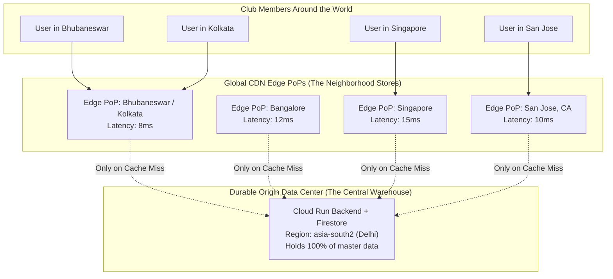

# Chapter 02: What is a CDN and Edge PoPs?

> *"The fastest packet is the one that never has to cross an ocean."*

---

## 1. The Central Dairy vs. The Neighborhood Kirana Store

Imagine you wake up at 7:00 AM on a Sunday morning and want a cup of hot chai with fresh milk.

Now imagine there is only **one single dairy farm in the entire country**, located in the foothills of Punjab:

```
[Your Kitchen in Bhubaneswar] ═══════════ (1,800 Kilometers) ═══════════> [Dairy Farm in Punjab]
```

If you had to get in your car, drive 1,800 kilometers across state lines, stand in line at the dairy barn, buy a 500 mL pouch of milk, and drive 1,800 kilometers back home:
- Your chai would take **three days** to make.
- The highway would be jammed with millions of other chai drinkers driving to Punjab.
- The dairy farm's driveway would collapse under the weight of a million cars.

Obviously, civilization does not work this way. Instead, human society invented **distribution networks**:

```
                       [Central Dairy in Punjab]
                                   │
                                   ▼ (Bulk delivery via overnight trucks)
                   ┌───────────────────────────────┐
                   │ Regional Distribution Centers │
                   └───────────────┬───────────────┘
                                   │
                   ┌───────────────┴───────────────┐
                   ▼                               ▼
    [Kirana Store: Saheed Nagar]      [Kirana Store: Jaydev Vihar]
                   │
                   ▼ (2-minute walk)
        [Your Morning Chai Cup]
```

The neighborhood *Kirana store* (or corner bodega) does not own the cows. It does not produce milk. It is simply a **localized, temporary holding station (a Cache)** placed a 2-minute walk from your front door. It keeps 20 pouches of milk in a refrigerated cooler. When you need milk, you walk 200 meters, grab it, and make your chai in 5 minutes.

---

## 2. Translating This to the Internet

In web architecture:
- The **Origin Server** is the **Central Dairy Farm in Punjab**.
- The **CDN (Content Delivery Network)** is the **global network of neighborhood Kirana stores**.
- An **Edge PoP (Point of Presence)** is an individual neighborhood store in a specific city.



### Definitions to Memorize

1. **Origin Server:** The authoritative, permanent primary home of your code and database. In our United89 application, this is the Google Cloud Run container and Firestore database running in Google Cloud's `asia-south2` region.
2. **CDN (Content Delivery Network):** A globally distributed network of thousands of proxy servers operated by cloud infrastructure providers like Google Cloud CDN, Cloudflare, Fastly, or AWS CloudFront.
3. **Edge PoP (Point of Presence):** A physical data center containing server racks, high-speed RAM, and NVMe SSD drives placed directly inside Internet Exchange Points (IXPs) and local Internet Service Providers (like Airtel, Jio, Comcast, or Vodafone) across hundreds of metropolitan cities.

---

## 3. Anycast Routing: How Your Phone Finds the Nearest PoP

When an alumnus in Bhubaneswar taps on `https://united89-club.web.app/yaadein`, how does their phone know to talk to the local Kolkata/Bhubaneswar Edge server instead of one in Tokyo or London?

### The Postal Zip Code Analogy

When you dial **112** (or 911) on your phone for emergency services:
- You do **not** get routed to a national emergency call center 2,000 miles away in the capital.
- The phone network routes you to the dispatcher sitting at the police station three streets away from where your phone is pinging the cell tower.

In computer networking, this magic is called **Anycast DNS & BGP (Border Gateway Protocol) Routing**.

```
Normal "Unicast" Routing:
IP Address 35.244.180.12 belongs to ONE computer in Frankfurt.
Every packet from everywhere on Earth must travel to Frankfurt.

Anycast Routing:
IP Address 199.36.158.100 is announced by 300 CDN servers SIMULTANEOUSLY!
Your local ISP inspects its network map and sends your packet
to whichever physical server is the fewest optical hops away!
```

When an alumnus in Bhubaneswar requests a photo:
1. His phone asks: *"Who owns united89-club.web.app?"*
2. Google's Anycast DNS replies with an IP address shared by Google edge nodes worldwide.
3. Airtel or Jio connects his phone to Google's edge cache in Eastern India (**8ms away**).
4. An alumnus living in New Jersey connects to Google's edge cache in Newark (**5ms away**).

Neither user has to cross an ocean to fetch the photo!

---

## 4. Origin vs. Edge: Who Does What?

A beginner often asks: *"If Edge servers are so fast, why don't we run our entire database and all our Python code on the Edge?"*

Because Edge servers and Origin servers have fundamentally different superpowers and trade-offs:

| Characteristic | Origin Server (Central Warehouse) | Edge PoP (Neighborhood Store) |
| :--- | :--- | :--- |
| **Location** | 1 or 2 centralized regions (e.g. `asia-south2`) | 200+ cities across the globe |
| **Storage Capacity** | Massive (Petabytes/Exabytes of disks) | Limited (Gigabytes/Terabytes of high-speed RAM/SSD) |
| **Data Permanence** | **Permanent (Source of Truth)** | **Ephemeral (Temporary Cache)** |
| **What Runs Here?** | Business logic, Firestore writes, admin RBAC, user auth | Static files, cached images, TLS termination, SSL handshakes |
| **Cost Profile** | Expensive compute and database query costs | Pennies per Gigabyte of cached egress |
| **Speed to User** | 150ms – 350ms (depending on user location) | **5ms – 25ms (instantaneous)** |

### Rule of Thumb
- **Dynamic, Private, or Mutation Requests** (e.g. *"Check my password"*, *"Did I answer Question 4 correctly?"*, *"Submit a new memory for admin approval"*) $\implies$ **Must go to Origin**.
- **Static, Public, or Reusable Media Requests** (e.g. *"Show photo #12"*, *"Download the CSS stylesheet"*, *"Load the JavaScript bundle"*) $\implies$ **Must be served by the Edge PoP**.

---

## 5. How Our Repository Configures the Edge CDN

Let's look at the actual production configuration in [`quiz-app/firebase.json`](file:///Users/divyadarshee.das/Desktop/Pers/United89-club-app/quiz-app/firebase.json):

```json
{
  "hosting": [
    {
      "site": "united89-club",
      "public": "public",
      "headers": [
        {
          "source": "/yaadein/**",
          "headers": [
            {
              "key": "Cache-Control",
              "value": "public, max-age=31536000, s-maxage=31536000, immutable"
            }
          ]
        }
      ],
      "rewrites": [
        {
          "source": "**",
          "run": {
            "serviceId": "united89-quiz-frontend",
            "region": "asia-south2"
          }
        }
      ]
    }
  ]
}
```

Notice what is happening here:
1. **The Edge Proxy:** Firebase Hosting acts as Google's global CDN Edge network fronting our container.
2. **The Rewrites Block:** Any general page navigation (`/**`) is routed to our container running in `asia-south2`.
3. **The Headers Block:** Any request matching `/yaadein/**` receives an explicit instruction:
   ```http
   Cache-Control: public, max-age=31536000, s-maxage=31536000, immutable
   ```
   This command tells the Google Edge PoP:  
   *"Keep this image in your local city edge memory for up to 1 full year (`31,536,000` seconds). Do not bother asking the backend container in `asia-south2` again!"*

In the next chapter, we will look under the hood at the exact lifecycle of a request: **What happens on the very first visit (Cache Miss) versus every subsequent visit (Cache Hit)?**

---

### [$\leftarrow$ Previous: Chapter 01](file:///Users/divyadarshee.das/Desktop/Pers/United89-club-app/docs/cdn-system-design-course/01-the-problem-why-media-is-hard.md) | [Next: Chapter 03 — Pull vs. Push CDNs $\to$](file:///Users/divyadarshee.das/Desktop/Pers/United89-club-app/docs/cdn-system-design-course/03-pull-vs-push-cdns-and-read-through-caching.md)
