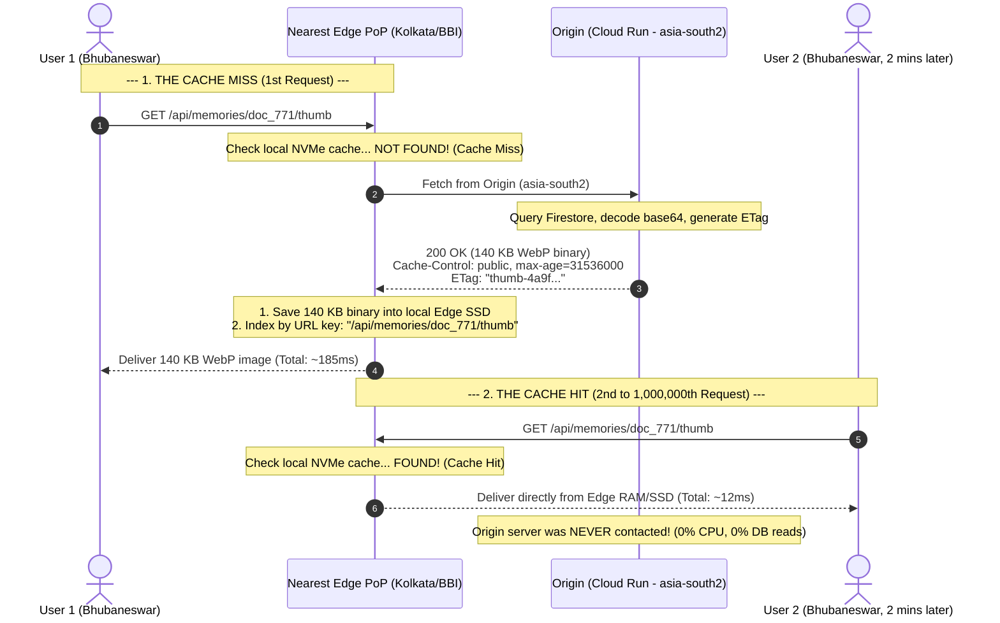

# Chapter 03: Pull vs. Push CDNs and Read-Through Caching

> *"Don't do work until someone actually asks for it. But once you do it, never do it twice."*

---

## 1. The Two Distribution Philosophies

When engineers want to distribute files across the globe, they have two architectural choices:
1. **Push CDN:** Proactively send files to every edge server in the world *before* anyone asks.
2. **Pull CDN:** Leave files at the origin, and let edge servers fetch them *on demand* the first time someone asks.

To understand why this choice matters, let us look at two real-world analogies: **The Morning Newspaper vs. The Public Library**.

---

### Analogy A: The Push CDN (The Morning Newspaper)

Every morning at 4:30 AM, a delivery truck drives from the printing press to every neighborhood newsstand in the city. The delivery driver dumps 100 printed copies of the daily paper onto each newsstand's sidewalk.

- The newsstand did **not** call the factory and ask for those papers.
- The factory **pushed** the papers out proactively.
- Even if nobody in a quiet neighborhood buys a newspaper that morning, the papers are already sitting there.

```
[Central Printing Press] ──(Push 100% of files)──► [Edge Newsstand A]
                                                ──► [Edge Newsstand B]
                                                ──► [Edge Newsstand C]
```

#### Where Push CDNs Make Sense
- **Massive Scheduled Game Updates:** When Epic Games releases a **25 Gigabyte update** for *Fortnite* on a Tuesday afternoon at 3:00 PM, millions of players will hit "Download" at the exact same second. If the CDN waited for the first download request, origin servers would be instantly crushed. Epic **pushes** the 25 GB patch to all global edge nodes hours before the update goes live.
- **Operating System Updates:** Apple pushing a new iOS release to 1 billion iPhones worldwide.

#### Why Push CDNs Are Terrible for Web Apps
- **Wasted Storage:** If your app has 100,000 photos, pushing all 100,000 photos to 300 global edge PoPs means storing $100,000 \times 300 = 30,000,000$ files across edge servers!
- **Edge Storage is Expensive:** Edge RAM and NVMe SSD space costs 5× to 10× more than bulk cloud storage.
- **Cold Content:** 80% of photos will only ever be viewed by users in one or two cities. Pushing a photo of an alumni meetup in Bhubaneswar to an edge server in Santiago, Chile is a complete waste of network bandwidth and money.

---

### Analogy B: The Pull CDN (The Library on Demand)

Now consider a large city research library with 500,000 rare books:
- The library does **not** keep all 500,000 books sitting on the open reading room tables. That would require a reading room the size of five football stadiums!
- Instead, all 500,000 books live in a secure, climate-controlled **central basement archive (The Origin)**.
- When an engineering student named Priya walks up to the librarian and asks for *"Fluid Mechanics, 3rd Edition"*, the librarian checks the **front-desk cart (The Edge Cache)**:

```
Scenario 1 (The First Request - Cache Miss):
1. The book is NOT on the front desk cart.
2. The librarian walks down into the basement archive (takes 5 minutes).
3. The librarian brings the book upstairs, places it on the front desk,
   and hands Priya a copy.

Scenario 2 (The Next Request - Cache Hit):
Ten minutes later, another student named Rahul walks up and asks for
"Fluid Mechanics, 3rd Edition".
The librarian does NOT walk down to the basement!
The book is already sitting right there on the front desk cart!
The librarian hands it to Rahul in 2 seconds.
```

This pattern is known in computer science as a **Read-Through Cache** (or **Pull Cache**).

---

## 2. Step-by-Step: The Request Lifecycle in a Pull CDN

Let us trace what happens when an alumnus uploads a new photo to the Yaadein gallery in our app.

Suppose the photo is given the unique URL:
`https://united89-club.web.app/api/memories/doc_771/thumb`



---

### Step-by-Step Breakdown:

#### 1. The Cache Miss (Request 1)
1. **Client Arrival:** User 1 in Bhubaneswar opens the page. The browser requests `/api/memories/doc_771/thumb`.
2. **Edge Lookup:** The packet hits the local Google Edge PoP (Point of Presence) in Eastern India. The Edge checks its internal hash table for the key `/api/memories/doc_771/thumb`.
3. **Miss Penalty:** The file is not in edge storage. This is a **Cache Miss**.
4. **Origin Pull:** The Edge PoP holds the user's connection open and sends an internal backbone request to our Origin server running on Cloud Run in `asia-south2` (Delhi).
5. **Origin Processing:** Our FastAPI endpoint in [`quiz-app/backend/routers/memories.py`](file:///Users/divyadarshee.das/Desktop/Pers/United89-club-app/quiz-app/backend/routers/memories.py) executes:
   - Reads the document from Firestore.
   - Decodes the thumbnail data.
   - Calculates the SHA-256 ETag.
   - Returns the binary bytes with `Cache-Control: public, max-age=31536000, s-maxage=31536000, immutable`.
6. **Edge Ingestion:** The Edge PoP receives the response, writes the binary payload into its fast local NVMe SSD cache, and marks it as valid for 1 year.
7. **Delivery:** The Edge forwards the image to User 1. Total latency: **~185ms**.

#### 2. The Cache Hit (Requests 2 through 1,000,000)
1. Two minutes later, User 2 (or 50 other alumni in Odisha) opens the gallery.
2. Their browser requests the exact same URL: `/api/memories/doc_771/thumb`.
3. The request arrives at the same local Edge PoP.
4. **Hit:** The Edge PoP finds the image already sitting warm in its NVMe SSD / RAM cache.
5. **Instant Response:** The Edge streams the binary image directly to User 2 in **12 milliseconds**.
6. **Origin Relief:** The Origin server in Delhi experiences **zero CPU load, zero memory usage, and zero Firestore read costs**.

---

## 3. The Power of Cache Hit Ratio (CHR)

In system design, the efficiency of a caching layer is measured by one crucial formula:

$$\text{Cache Hit Ratio (CHR)} = \frac{\text{Total Cache Hits}}{\text{Total Requests}} \times 100\%$$

Let us see what happens to our club app during the reunion with 1,000 active alumni:

$$\text{Total Requests for Photo 771} = 1,000$$

$$\text{Cache Misses} = 1 \quad (\text{only the very first user})$$

$$\text{Cache Hits} = 999$$

$$\text{Cache Hit Ratio} = \frac{999}{1,000} \times 100\% = \mathbf{99.9\%}$$

### What does 99.9% CHR mean for our infrastructure?
- **Server Load Reduced by 99.9%:** The origin server only handled **1 request** instead of 1,000!
- **Database Reads Reduced by 99.9%:** We paid Firestore for **1 read operation** instead of 1,000!
- **Latency Cut by 93%:** 999 users experienced a lightning-fast 12ms load time instead of waiting 185ms.

---

## 4. Connecting the Code: Origin Configuration

In [`quiz-app/backend/routers/memories.py`](file:///Users/divyadarshee.das/Desktop/Pers/United89-club-app/quiz-app/backend/routers/memories.py), look at lines 139-146 in the `get_memory_thumbnail` endpoint:

```python
return Response(
    content=binary_bytes,
    media_type=mime_type,
    headers={
        "ETag": etag,
        "Cache-Control": "public, max-age=31536000, s-maxage=31536000, immutable",
    },
)
```

By returning this specific `Cache-Control` header on the Cache Miss response, **the backend instructs the Pull CDN to cache the response for all subsequent users**.

In the next chapter, we will answer a vital question: **Does a CDN have infinite storage? What happens when the Edge PoP runs out of disk space?**

---

### [$\leftarrow$ Previous: Chapter 02](file:///Users/divyadarshee.das/Desktop/Pers/United89-club-app/docs/cdn-system-design-course/02-what-is-a-cdn-and-edge-pops.md) | [Next: Chapter 04 — LRU Cache & Eviction $\to$](file:///Users/divyadarshee.das/Desktop/Pers/United89-club-app/docs/cdn-system-design-course/04-lru-cache-and-eviction-deep-dive.md)
