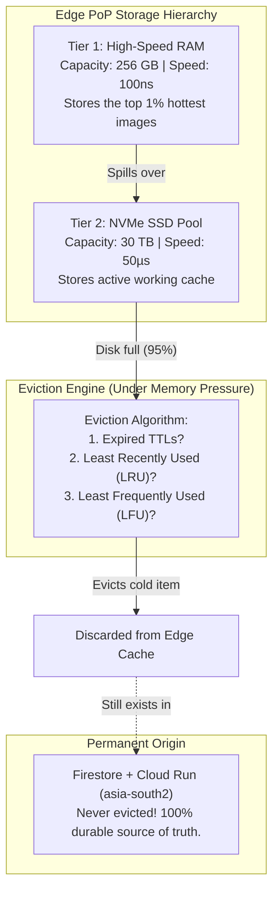

# Chapter 04: LRU Cache and Eviction Deep Dive

> *"A cache that never throws anything away is not a cache. It is a slow, leaky database."*

---

## 1. The Million-Dollar Myth

When software engineers first learn about HTTP caching headers, they write code like this:

```python
headers = {
    "Cache-Control": "public, max-age=31536000, s-maxage=31536000, immutable"
}
```

They see `31536000` seconds (which equals exactly 365 days) and think:  
*"Fantastic! The CDN will store my image in its edge memory for the next 365 days guaranteed!"*

**This is 100% false.**

`max-age` is an **upper limit ceiling**, not a lease of guaranteed residency. It simply tells the CDN:  
*"You are permitted to keep this file for up to one year. But if you run low on memory, you may throw it away at any second."*

To understand why, we must understand the physical constraints of Edge PoP hardware and the algorithm that governs all modern caches: **LRU (Least Recently Used) Eviction**.

---

## 2. The Apartment Closet Analogy

Imagine you live in a cozy studio apartment with a small clothes closet that holds only **10 shirts**.

```
[Your 10-Shirt Closet] (Fast, immediate access in your bedroom)
vs.
[Your Parents' Attic 500 km away] (Infinite storage, but takes days to retrieve anything)
```

- When winter arrives, you buy a new heavy wool sweater.
- Your closet already holds 10 shirts. It is completely full.
- What do you do? You cannot magically stretch the wooden walls of your closet.
- You look at your shirts and find the one shirt you have **not worn in the longest time** (say, a neon green summer Hawaiian shirt you haven't touched since July).
- You take the Hawaiian shirt out of the closet and pack it into a storage box to take to the attic.
- You hang the new wool sweater in the closet.

```
Is the Hawaiian shirt destroyed?
NO! It still exists safely in the attic (The Origin).
If you suddenly take a vacation to Goa in February, you can retrieve it from the attic,
bring it back to your apartment, and hang it back in the closet!
```

---

## 3. The Physical Reality of an Edge Server

Why can't an Edge PoP in Bhubaneswar or Singapore keep every file for a year?

Consider what happens inside a single Google Cloud CDN or Cloudflare Edge Data Center:
- That Edge PoP does not just serve our club app!
- It serves thousands of other websites: YouTube thumbnails, Spotify album art, Shopify storefronts, news articles, and mobile app updates.
- The Internet creates **exabytes** (millions of terabytes) of new content every week.
- A physical edge server rack typically has:
  - **128 GB to 512 GB of RAM** (Tier 1 L1 Cache: Ultra-fast, ~100 nanosecond access).
  - **4 TB to 30 TB of NVMe SSDs** (Tier 2 L2 Cache: Very fast, ~50 microsecond access).

When that 30 TB SSD reaches 95% capacity, **the server must delete old files to make room for incoming files**.



---

## 4. How LRU (Least Recently Used) Works

The most popular cache replacement algorithm in computer science is **LRU**.

### The Core Rule of LRU:
> When the cache is full and new space is required, **discard the item that was accessed least recently**.

Every time an item is requested, it moves to the **"Front" (Most Recently Used)** of the line. The item that has sat untouched the longest drifts toward the **"Back" (Least Recently Used)**.

### The $O(1)$ Data Structure
How do production edge proxies implement LRU without slowing down?
If you used a simple array or list, finding an item takes $O(N)$ time, and reordering items takes $O(N)$ time. When serving 100,000 requests per second, $O(N)$ is too slow.

An LRU cache combines two classical data structures to achieve **$O(1)$ constant-time lookup, insertion, and deletion**:
1. **A Hash Map (Dictionary):** Maps the URL key to a node pointer for instant $O(1)$ lookup.
2. **A Doubly Linked List:** Maintains the order of recency. Moving a node to the front or deleting a node from the tail takes $O(1)$ pointer operations.

```
   [Most Recently Used (Head)]                       [Least Recently Used (Tail)]
            │                                                      │
            ▼                                                      ▼
     ┌──────────────┐         ┌──────────────┐              ┌──────────────┐
     │  Photo #99   │ <=====> │  Photo #42   │ <==========> │  Photo #03   │
     │  (Hot item)  │         │ (Warm item)  │              │ (Cold item)  │
     └──────────────┘         └──────────────┘              └──────────────┘
            ▲                                                      ▲
            │                                                      │
    Any new request moves                                  If cache fills up,
       here immediately!                                   THIS gets evicted!
```

---

## 5. An LRU Cache in Python (Under the Hood)

Here is a simplified Python implementation showing exactly how a CDN edge proxy manages memory:

```python
class Node:
    def __init__(self, key: str, value: bytes):
        self.key = key
        self.value = value
        self.prev = None
        self.next = None

class EdgeLRUCache:
    def __init__(self, capacity_items: int):
        self.capacity = capacity_items
        self.map = {}  # key -> Node (O(1) lookup)
        # Dummy head and tail nodes to avoid edge-case null pointer checks
        self.head = Node("HEAD", b"")
        self.tail = Node("TAIL", b"")
        self.head.next = self.tail
        self.tail.prev = self.head

    def _remove(self, node: Node):
        """Detach node from its current position in the linked list."""
        prev_node = node.prev
        next_node = node.next
        prev_node.next = next_node
        next_node.prev = prev_node

    def _add_to_front(self, node: Node):
        """Insert node right behind head (Most Recently Used position)."""
        node.next = self.head.next
        node.prev = self.head
        self.head.next.prev = node
        self.head.next = node

    def get(self, key: str) -> bytes | None:
        """Cache Lookup: O(1) time complexity."""
        if key not in self.map:
            return None  # CACHE MISS!

        node = self.map[key]
        # Move accessed node to front (now Most Recently Used)
        self._remove(node)
        self._add_to_front(node)
        return node.value  # CACHE HIT!

    def put(self, key: str, value: bytes):
        """Cache Store: O(1) time complexity."""
        if key in self.map:
            self._remove(self.map[key])
        elif len(self.map) >= self.capacity:
            # EVICTION TIME: Discard the least recently used node (at the tail)
            lru_node = self.tail.prev
            self._remove(lru_node)
            del self.map[lru_node.key]
            print(f"[EDGE EVICTION] Disk full! Evicted cold asset: {lru_node.key}")

        new_node = Node(key, value)
        self.map[key] = new_node
        self._add_to_front(new_node)
```

---

## 6. LFU vs. TTL: The Other Eviction Triggers

While LRU is the most common algorithm, production CDNs also use two complementary strategies:

### 1. TTL (Time-To-Live) Eviction
Every cached item carries an internal timer based on its `max-age` or `s-maxage` header. Once the clock strikes 0:
- The edge does **not** necessarily delete the file instantly.
- It marks the file as **stale**.
- The next time a user asks for it, the edge sends a lightweight conditional validation request (using `ETag` and `If-None-Match`, which we cover in Chapter 06) back to the Origin.

### 2. LFU (Least Frequently Used) Eviction
Imagine a photo from the 1989 convocation that 500 alumni view every single day. One night, an alumnus uploads 20 photos of his garden flowers that are viewed once and never again.
- A pure LRU cache might accidentally evict the popular convocation photo because the 20 garden photos were uploaded more recently!
- **LFU (Least Frequently Used)** keeps track of **access counters**. Even if the convocation photo hasn't been viewed in 12 hours, its counter is 10,000, while the garden photo counter is 1. The edge protects the frequently accessed photo and evicts the low-frequency item.
- Modern CDNs like Cloudflare and Fastly use hybrid algorithms such as **SLRU (Segmented LRU)** or **W-TinyLFU** to combine the best of both worlds.

---

## 7. The Golden Takeaway for Engineers

When you design a media application:
1. **Never rely on the CDN as your only copy of a file!** An Edge PoP is a temporary cache. An asset can be evicted 10 minutes after being cached if local disk pressure spikes.
2. **The Origin must always be durable.** In our app, Firestore and Cloud Run in `asia-south2` hold 100% of the data permanently. If an edge node evicts a memory photo, nothing is broken—the next request will simply experience a transparent 180ms Cache Miss, reload the photo from Origin, and restore it to the local edge cache!

In the next chapter, we will master the universal language used by browsers, CDNs, and backends to govern caching: **HTTP Caching Headers**.

---

### [$\leftarrow$ Previous: Chapter 03](file:///Users/divyadarshee.das/Desktop/Pers/United89-club-app/docs/cdn-system-design-course/03-pull-vs-push-cdns-and-read-through-caching.md) | [Next: Chapter 05 — HTTP Caching Headers $\to$](file:///Users/divyadarshee.das/Desktop/Pers/United89-club-app/docs/cdn-system-design-course/05-http-caching-headers-explained.md)
