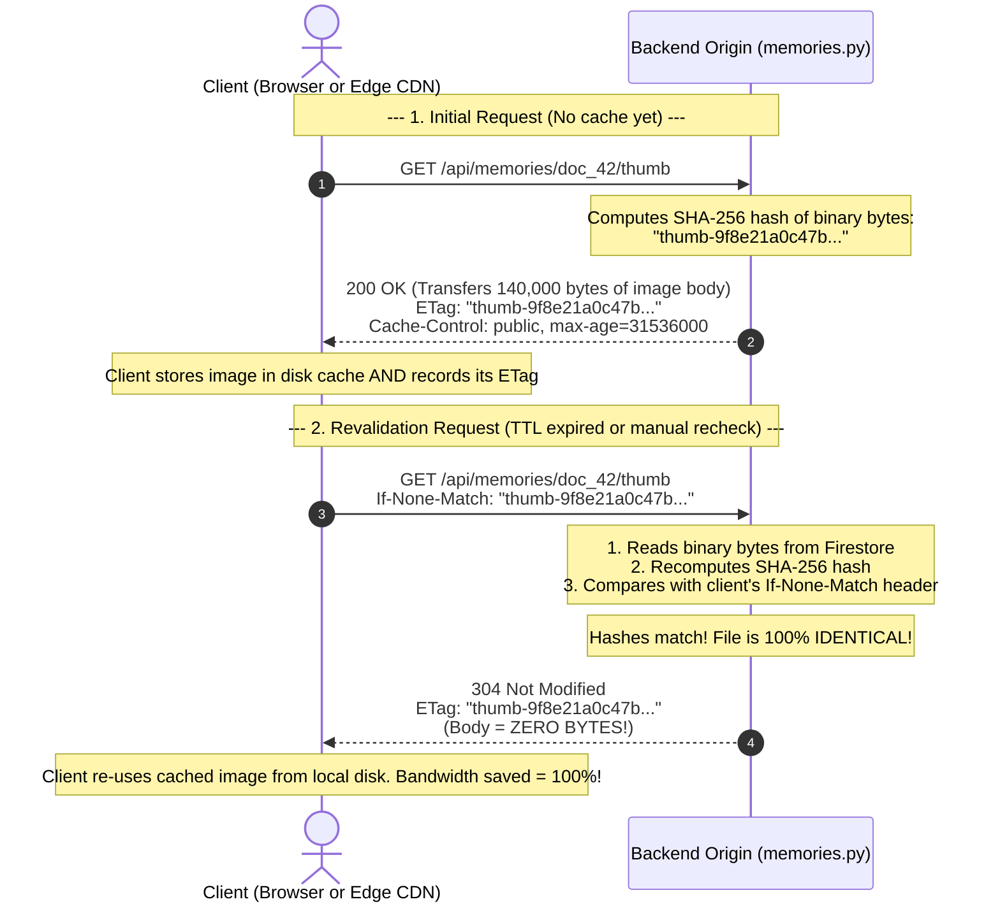

# Chapter 06: ETags, Hashing, and 304 Not Modified

> *"Why download 6 Megabytes across the globe just to discover that not a single pixel has changed?"*

---

## 1. The Royal Wax Seal Analogy

Centuries ago, before the invention of telephones or secure email, a King in one country would send confidential treaty documents to a King in another country.

To ensure that no spy opened or modified the scrolls during the long journey, the royal scribe would melt red beeswax onto the envelope flap and press the King's personal signet ring into the hot wax.

```
       ┌────────────────────────────────────────────────────────┐
       │                 ROYAL OFFICIAL TREATY                  │
       │                                                        │
       │   Seal Stamp: [ Lion Head Crest #8942-A ]              │
       └────────────────────────────────────────────────────────┘
```

When the second King received the letter:
1. He did not need to re-read all 50 pages of the treaty to verify its authenticity.
2. He simply inspected the wax seal: *"Is the Lion Head Crest #8942-A intact?"*
3. If the seal matched his ledger, he knew with 100% mathematical certainty that not a single word had been altered.

In modern web architecture, an **`ETag` (Entity Tag)** is the digital royal wax seal.

---

## 2. What is an ETag?

An **ETag** is an HTTP response header that acts as a **cryptographic fingerprint** of a specific resource's exact binary bytes.

In computer science, a cryptographic hash function (like **SHA-256**) takes any arbitrary stream of binary data—whether it is a 10-byte text message or a 7-Megabyte 4K photograph—and converts it into a unique, fixed-length hexadecimal string:

```
Binary Image A (6,291,456 bytes) ──[ SHA-256 Engine ]──► "e3b0c44298fc1c149afbf4c8996fb924"
```

### The Avalanche Effect
Cryptographic hashes have a magic property called the **Avalanche Effect**:
- If you change **just one single pixel** from pure black `(0, 0, 0)` to dark gray `(0, 0, 1)`, the resulting SHA-256 hash changes completely!
- But if **not a single byte has changed**, running SHA-256 on that image will produce the exact same fingerprint every single time.

---

## 3. The 304 Not Modified Handshake

Let us see how the client and the server use this fingerprint to save massive amounts of network bandwidth.



---

## 4. Code Walkthrough: Production ETag Logic

Let us look at how this is implemented in [`quiz-app/backend/routers/memories.py`](file:///Users/divyadarshee.das/Desktop/Pers/United89-club-app/quiz-app/backend/routers/memories.py).

### In the Thumbnail Endpoint (lines 127–146):

```python
# 1. Decode the raw binary bytes of the image
binary_bytes = base64.b64decode(b64_payload)

# 2. Compute a SHA-256 fingerprint of the binary bytes (taking the first 28 hex characters)
etag = f'"thumb-{hashlib.sha256(binary_bytes).hexdigest()[:28]}"'

# 3. Check if the incoming request already has this exact fingerprint!
if request.headers.get("if-none-match") == etag:
    return Response(
        status_code=304,
        headers={
            "ETag": etag,
            "Cache-Control": "public, max-age=31536000, s-maxage=31536000, immutable",
        },
    )

# 4. If fingerprints don't match, return the full binary payload
return Response(
    content=binary_bytes,
    media_type=mime_type,
    headers={
        "ETag": etag,
        "Cache-Control": "public, max-age=31536000, s-maxage=31536000, immutable",
    },
)
```

### In the High-Resolution Master Endpoint (lines 184–201):

```python
# Compute fingerprint on the reassembled master binary
etag = f'"{hashlib.sha256(binary_bytes).hexdigest()[:32]}"'

if request.headers.get("if-none-match") == etag:
    return Response(
        status_code=304,
        headers={
            "ETag": etag,
            "Cache-Control": "public, max-age=31536000, s-maxage=31536000, immutable",
        },
    )

return Response(
    content=binary_bytes,
    media_type=mime_type,
    headers={
        "ETag": etag,
        "Cache-Control": "public, max-age=31536000, s-maxage=31536000, immutable",
    },
)
```

---

## 5. The Math: Bandwidth Savings of a 304 Response

Let us compare the payload size of a standard `200 OK` vs a `304 Not Modified` response for a 5.5 MB high-resolution photo:

| Metric | `200 OK` (Full Download) | `304 Not Modified` (Validation) | Savings |
| :--- | :--- | :--- | :--- |
| **HTTP Headers Size** | ~350 bytes | ~200 bytes | ~40% |
| **HTTP Body Size** | **5,767,168 bytes (5.5 MB)** | **0 bytes** | **100.0%** |
| **Total Transfer** | **~5.5 MB** | **~0.0002 MB** | **99.996%** |
| **Transfer Time (4G)** | ~2,500 ms | **~15 ms** | **99.4% faster** |

When an Edge CDN revalidates its stale cache items with the Origin in `asia-south2`, returning a `304 Not Modified` ensures that **not a single megabyte of egress bandwidth is billed by Google Cloud**, and the user experiences zero lag!

---

## 6. Strong vs. Weak ETags

In HTTP specifications, you will often see two kinds of ETags:

1. **Strong ETag (What we use):**
   ```http
   ETag: "9f8e21a0c47b74..."
   ```
   - Indicates **byte-for-byte identical content**.
   - If the ETag matches, the binary stream on the client is guaranteed to match the server's byte for byte.
   - Essential for byte-range requests (like video streaming or chunked image downloads).

2. **Weak ETag:**
   ```http
   ETag: W/"9f8e21a0c47b74..."
   ```
   - The `W/` prefix indicates **semantic equivalence**, but not necessarily byte-level identity.
   - For example, if an HTML page has the same text but different whitespace or gzip compression levels, a server might issue a Weak ETag.

Because images are binary files where every byte must be preserved, **always generate Strong ETags using SHA-256 for media assets**.

In the next chapter, we will tackle the most feared problem in computer science: **Cache Invalidation, and why Content-Addressed URLs are the ultimate cure**.

---

### [$\leftarrow$ Previous: Chapter 05](file:///Users/divyadarshee.das/Desktop/Pers/United89-club-app/docs/cdn-system-design-course/05-http-caching-headers-explained.md) | [Next: Chapter 07 — Cache Invalidation & Immutable URLs $\to$](file:///Users/divyadarshee.das/Desktop/Pers/United89-club-app/docs/cdn-system-design-course/07-cache-invalidation-and-immutable-urls.md)
