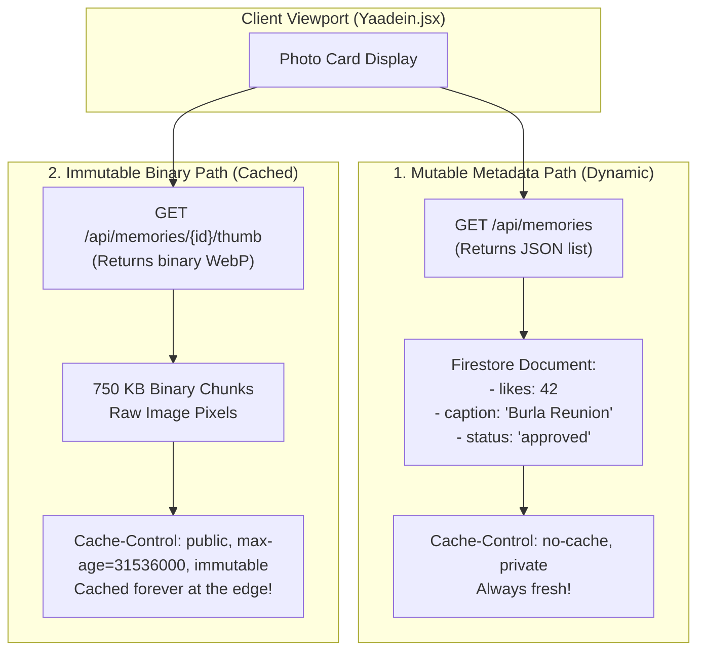

# Chapter 07: Cache Invalidation and Immutable URLs

> *"There are only two hard things in Computer Science: cache invalidation and naming things."*  
> — Phil Karlton

---

## 1. The Tale of the Overwritten Profile Picture

Consider a classic bug that every web developer experiences at least once in their career:

1. A user named Sneha creates an account on a social app.
2. She uploads a profile picture. The backend saves it to:
   ```
   https://club.com/avatars/sneha.jpg
   ```
3. The server sets:
   ```http
   Cache-Control: public, max-age=31536000
   ```
4. A week later, Sneha decides to upload a new, professional headshot.
5. The backend happily overwrites the old `sneha.jpg` file with her new photo.
6. Sneha refreshes her profile. **She still sees her old photo.**
7. Her friend in Bangalore opens her profile. **Her friend sees the old photo.**
8. Sneha's friend in Singapore opens her profile. **Singapore sees the new photo!**

Sneha files an angry support ticket: *"Your app is broken! I changed my picture three days ago, but everyone is seeing different things!"*

---

## 2. Why Manual Cache Invalidation is a Nightmare

What went wrong in Sneha's scenario?

When you overwrite an asset under an existing URL (like `sneha.jpg`):
1. **The Browser Layer:** Sneha's local browser already cached `sneha.jpg` with a 1-year expiration timer. The browser will not even check the internet.
2. **The Edge CDN Layer:** The CDN PoP in Mumbai has a cached copy of the old `sneha.jpg`. The CDN PoP in Singapore happened to evict it yesterday, so Singapore fetched the new one.
3. **The Purge Problem:** To fix this, your backend must call a CDN API:
   ```bash
   POST https://api.cloudflare.com/client/v4/zones/.../purge_cache
   {"files": ["https://club.com/avatars/sneha.jpg"]}
   ```
   - Across 300 global data centers, propagating a purge takes **from 30 seconds to 15 minutes**.
   - Cloud providers charge money for cache purge API calls beyond a monthly quota.
   - And the purge API **cannot reach inside Sneha's phone** to clear her local browser cache!

---

## 3. The Modern Solution: Content-Addressable & Immutable URLs

Instead of trying to clear the world's caches, modern system design uses a much simpler, foolproof principle:

> **NEVER MUTATE AN ASSET UNDER AN EXISTING URL.**  
> If an asset changes, give it a brand-new, unique URL!

### The ISBN Book Analogy
When a publisher updates a textbook from the 2nd Edition to the 3rd Edition:
- They do **not** drive to every library in the world and use an eraser to change words on the printed pages.
- They issue a **brand-new ISBN number** and a new edition title:  
  `ISBN 978-0-13-110362-7` $\implies$ `ISBN 978-0-13-110363-4`.
- The old book remains in the library archive. The new book arrives as a distinct object.

```
Mutable (Anti-Pattern):
https://club.com/photos/latest_memory.jpg  <-- If content changes, caches break!

Immutable (Production Pattern):
https://club.com/api/memories/doc_9841af/thumb  <-- Unique Firestore UUID!
https://club.com/assets/banner.a8f9c12b.webp     <-- Content hash in filename!
```

---

## 4. How Yaadein Implements Immutable URLs

Let us inspect how our club application enforces immutable URLs in [`quiz-app/backend/routers/memories.py`](file:///Users/divyadarshee.das/Desktop/Pers/United89-club-app/quiz-app/backend/routers/memories.py).

### 1. Generating a Globally Unique ID on Upload
When an alumnus uploads a photo in `create_memory` (line 230):

```python
doc_ref = db.collection("memories").document()  # Auto-generates a unique 20-character UUID
```

Every single upload receives a unique ID, such as `kL91zPq8xT2mN4vR7yU5`.

### 2. Deriving the Image URLs
In `_serialize_memory_doc` (lines 48–54):

```python
if is_chunked or raw_image.startswith("data:image/"):
    high_res_url = f"/api/memories/{doc_id}/image"
    image_url = f"/api/memories/{doc_id}/thumb" if has_thumb else high_res_url
```

Because `doc_id` is unique and never reused:
- `/api/memories/kL91zPq8xT2mN4vR7yU5/thumb` represents **only this exact photo**.
- If the user re-uploads the photo or uploads a different photo 5 seconds later, it gets a **different** `doc_id` (e.g. `vB33wE12xK...`).
- Therefore, the server can safely stamp:
  ```http
  Cache-Control: public, max-age=31536000, s-maxage=31536000, immutable
  ```
  The browser and CDN can cache it for 1 year with zero risk of serving stale content!

---

## 5. Separating Mutable Metadata from Immutable Media

A great system designer must distinguish between what changes and what stays the same.



### Notice the separation:
1. **The Metadata is Mutable:**
   - An alumnus taps the "Heart" like button. The like counter increases from 42 to 43.
   - An Admin updates the caption in the lightbox to fix a typo.
   - When the user opens the album, `GET /api/memories` returns the latest JSON metadata. Because this JSON endpoint is **not cached permanently**, the user instantly sees the new like count and updated caption.
2. **The Pixels are Immutable:**
   - The actual visual pixels of the photograph never change!
   - The browser does not need to re-download the image just because someone clicked "Like"!
   - The photo loads instantly from local disk cache, while the small 25 KB JSON metadata updates the text and heart counter in milliseconds.

In the next chapter, we will explore the critical architectural mistake of returning images inside JSON lists: **Separating Metadata Databases from Blob Storage**.

---

### [$\leftarrow$ Previous: Chapter 06](file:///Users/divyadarshee.das/Desktop/Pers/United89-club-app/docs/cdn-system-design-course/06-etags-hashing-and-304-not-modified.md) | [Next: Chapter 08 — Metadata DB vs. Blob Storage $\to$](file:///Users/divyadarshee.das/Desktop/Pers/United89-club-app/docs/cdn-system-design-course/08-separating-metadata-db-from-blob-storage.md)
