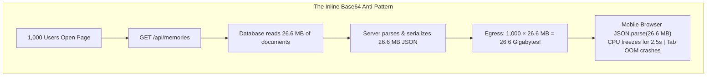

# Chapter 08: Separating Metadata DB from Blob Storage

> *"Databases are built for indexing, querying, and relationships. They are terrible filing cabinets for multi-megabyte binary blobs."*

---

## 1. The Anti-Pattern: The 26-Megabyte JSON Response

When junior engineers are asked to build an image gallery, their initial instinct is often:
1. Accept an uploaded image on the frontend as a Base64 string: `"data:image/jpeg;base64,/9j/4AAQSkZJRg..."`.
2. Store that entire Base64 string directly inside the database document:
   ```json
   {
     "id": "memory_101",
     "caption": "Reunion Dinner 2024",
     "image_base64": "data:image/jpeg;base64,/9j/4AAQSkZJRgABAQAAAQABAAD/2wBD..."
   }
   ```
3. When the user opens the gallery, the backend executes:
   ```python
   @router.get("/api/memories")
   def list_memories():
       return db.collection("memories").get()  # Returns everything!
   ```

**This is one of the most destructive architectural anti-patterns in modern web development.**

To understand why, let us calculate the numbers.

---

## 2. Back-of-the-Envelope Math: The Base64 Tax

### Why Does Base64 Add 33% Bloat?
Computers store binary data in 8-bit bytes (values 0 to 255). But standard text protocols like JSON cannot safely transmit raw binary bytes (they contain control characters, null bytes, and newlines that break JSON parsers).

To make binary safe for text, **Base64 encoding** takes 3 raw binary bytes (24 bits) and maps them into 4 printable ASCII characters (each character representing 6 bits):

$$\text{Base64 Overhead} = \frac{4\text{ characters}}{3\text{ bytes}} = 1.3333... \implies \mathbf{+33.3\%\text{ size increase!}}$$

If you have a compressed photo that is **300 Kilobytes** in raw binary:
- When converted to Base64, it swells to **400 Kilobytes** of text!
- You are paying for **100 KB of pure waste** on every single photo!

---

### The Catastrophic Gallery Calculation

Suppose our Yaadein album contains **100 batch memories**:

```
Number of Photos:           100
Average Binary Size:        200 KB
Average Base64 Size:        266 KB
Total JSON Response Size:   100 × 266 KB = 26,600 KB ≈ 26.6 Megabytes!
```

Now let us watch what happens when **1,000 alumni** open the app during reunion week:



### The 4 Lethal Consequences:
1. **Network Egress Collapse:** In less than two minutes, your backend server must stream **26.6 Gigabytes of JSON text** out of its network interface. The pipe clogs, and response times skyrocket to 15+ seconds.
2. **CPU Serialization Lockup:** In Python (FastAPI/Node.js), converting 26 MB of text into JSON strings consumes 100% of CPU cores. Other users trying to submit quiz answers get blocked by the server's event loop.
3. **The Mobile Main Thread Freeze:** When a mobile phone receives a 26.6 MB JSON response, JavaScript must run `JSON.parse()`. On an iPhone or mid-range Android phone, parsing a 26 MB string blocks the browser's main thread for **1.5 to 3 full seconds**. The screen freezes, animations stutter, and scrolling locks up completely.
4. **Zero Edge Caching:** Because `GET /api/memories` is a dynamic API that updates whenever someone likes a photo or adds a caption, you cannot easily cache this 26 MB JSON on the CDN for long periods!

---

## 3. The Clean Architecture: Metadata DB + Blob URLs

To fix this, we strictly separate **Metadata (Structured Information)** from **Blobs (Binary Large Objects)**:

```
┌───────────────────────────────────────┐       ┌───────────────────────────────────────┐
│        1. Metadata Database           │       │       2. Blob Storage & CDN           │
│         (Firestore / PostgreSQL)      │       │     (Google Cloud CDN / Buckets)      │
├───────────────────────────────────────┤       ├───────────────────────────────────────┤
│ • Document ID                         │       │ • High-resolution JPEG master         │
│ • Caption                             │       │ • Scaled WebP grid thumbnail          │
│ • Uploader name & phone               │       │ • Video MP4 files                     │
│ • Like counter                        │       │ • Raw binary camera files             │
│ • Moderation status                   │       │                                       │
│ • Thumbnail URL & Master URL          │       │                                       │
└───────────────────────────────────────┘       └───────────────────────────────────────┘
```

---

## 4. Code Walkthrough: Production Separation in Yaadein

Let us look at how [`quiz-app/backend/routers/memories.py`](file:///Users/divyadarshee.das/Desktop/Pers/United89-club-app/quiz-app/backend/routers/memories.py) implements this pattern:

### 1. Serializing Lightweight Metadata Only
Look at `_serialize_memory_doc` (lines 32–69):

```python
def _serialize_memory_doc(doc_id: str, data: dict) -> dict:
    """
    Serializes a Firestore memory document into a lightweight metadata record.
    Notice: We NEVER return image_data_url here!
    We only return lightweight URL pointers!
    """
    return {
        "id": doc_id,
        "caption": data.get("caption", ""),
        "image_url": f"/api/memories/{doc_id}/thumb",      # ~30 bytes
        "high_res_url": f"/api/memories/{doc_id}/image",   # ~30 bytes
        "uploader_name": data.get("uploader_name", "Club Member"),
        "uploader_phone": data.get("uploader_phone", ""),
        "status": data.get("status", "pending"),
        "likes": data.get("likes", 0),
        "width": data.get("width"),
        "height": data.get("height"),
        "size_bytes": data.get("size_bytes"),
        "created_at": created_at,
    }
```

Notice what is inside each record: **Zero image pixels!**  
Each serialized item is only about **250 bytes** of clean JSON.

---

### 2. The List API Response Size
In `list_memories` (lines 71–105):

```python
@router.get("")
async def list_memories(...):
    # Returns the lightweight metadata list
    return {"items": items, "is_admin": is_admin}
```

Let us re-run the math for 100 memories using this clean pattern:

$$100\text{ items} \times 250\text{ bytes} = \mathbf{25,000\text{ bytes (25 Kilobytes!)}}$$

```
Old Anti-Pattern:  26,600 KB  (26.6 MB)
Clean Pattern:         25 KB  (0.025 MB)

RESULT: 99.9% REDUCTION IN API PAYLOAD SIZE!
```

A 25 KB JSON response downloads over 4G in **15 milliseconds** and parses in **1 millisecond**.

---

## 5. Architectural Comparison Matrix

| Evaluation Metric | Inline Base64 in List API | Metadata DB + CDN URLs |
| :--- | :--- | :--- |
| **Payload Size (100 Photos)** | 26.6 Megabytes | **25 Kilobytes (99.9% smaller)** |
| **Network Egress (1k users)** | 26.6 Gigabytes | **0.025 Gigabytes** |
| **Time to First Render** | 4,000 ms – 12,000 ms | **80 ms – 180 ms** |
| **Mobile Browser Stability** | High risk of OOM crash | Rock solid |
| **CDN Cacheability** | Impossible (dynamic list) | **100% cacheable via immutable URLs** |
| **Bandwidth Efficiency** | Downloads all 100 images even if user closes tab after viewing 2 photos | **Only downloads images user actually scrolls to (`loading="lazy"`)** |

In the next chapter, we will solve the user experience dilemma: **How do we satisfy alumni who want 5–7 MB 4K printable photos without melting mobile browsers? Welcome to Dual-Tier Image Architecture**.

---

### [$\leftarrow$ Previous: Chapter 07](file:///Users/divyadarshee.das/Desktop/Pers/United89-club-app/docs/cdn-system-design-course/07-cache-invalidation-and-immutable-urls.md) | [Next: Chapter 09 — The Dual-Tier Image Pattern $\to$](file:///Users/divyadarshee.das/Desktop/Pers/United89-club-app/docs/cdn-system-design-course/09-the-5mb-to-7mb-high-res-problem-dual-tier-images.md)
