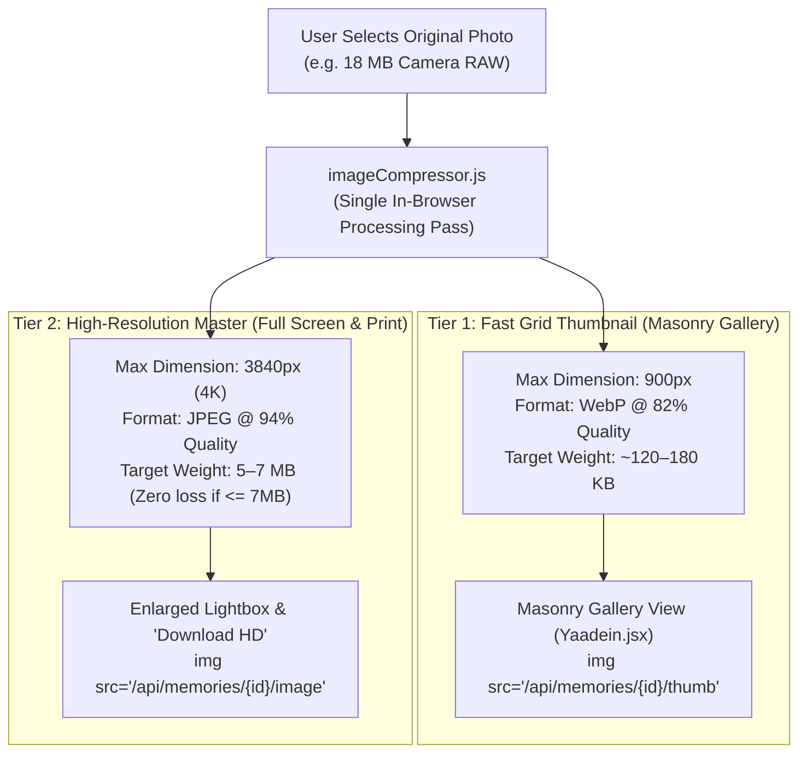

# Chapter 09: The 5–7 MB High-Res Problem: Dual-Tier Images

> *"A user scrolls through 50 photos in 10 seconds. They only stop to stare at one. Why download 50 high-resolution masters when they only needed one?"*

---

## 1. The Engineering Dilemma

In the [United89 Yaadein Gallery](file:///Users/divyadarshee.das/Desktop/Pers/United89-club-app/quiz-app/frontend/src/pages/Yaadein.jsx), our alumni have two completely opposing requirements:

```
                  ┌───────────────────────────────────────────────┐
                  │           THE IRRECONCILABLE DILEMMA          │
                  └───────────────────────┬───────────────────────┘
                                          │
            ┌─────────────────────────────┴─────────────────────────────┐
            ▼                                                           ▼
┌───────────────────────────────┐           ┌───────────────────────────────────────┐
│     Requirement A (Quality)   │           │      Requirement B (Performance)      │
│  "I want the original 4K/6 MB │           │  "The gallery must open instantly on  │
│   photo so I can zoom into my │           │   my phone over mobile 4G and scroll  │
│   friends' faces and print!"  │           │   at 60 FPS without crashing!"        │
└───────────────────────────────┘           └───────────────────────────────────────┘
```

If you choose **Only High-Res (6 MB)**:
- 50 photos $\times$ 6 MB = **300 Megabytes of download**.
- Mobile Safari and Chrome crash due to GPU texture memory exhaustion (as we calculated in Chapter 01).
- Page scrolling stutters with severe frame drops (jank).

If you choose **Only Aggressive Compression (100 KB)**:
- The gallery opens quickly.
- But when an alumnus opens the photo in full screen or clicks "Download", the photo looks like a blurry, pixelated oil painting. The alumni are deeply disappointed.

---

## 2. The Solution: Dual-Tier Image Architecture

The architectural pattern used by Google Photos, Instagram, and Yaadein is **Dual-Tier Image Ingestion**:



---

## 3. Tier 1 vs. Tier 2: Specifications

Let us examine the exact specifications we designed for both tiers in [`quiz-app/frontend/src/utils/imageCompressor.js`](file:///Users/divyadarshee.das/Desktop/Pers/United89-club-app/quiz-app/frontend/src/utils/imageCompressor.js):

| Attribute | Tier 1: Fast Grid Thumbnail | Tier 2: High-Resolution Master |
| :--- | :--- | :--- |
| **Primary Purpose** | Instant masonry browsing, mobile feed | Full-screen lightbox zoom, high-res download |
| **Max Dimension** | **900 pixels** (longest edge) | **3840 pixels** (4K UHD) |
| **File Format** | Modern **WebP** (fallback to JPEG) | Universal **JPEG** (preserving EXIF & sharpness) |
| **Compression Quality** | 82% lossy | 94% gentle lossy (or 100% untouched if $\le 7\text{ MB}$) |
| **Average File Size** | **~120 KB – 180 KB** | **5.0 MB – 7.0 MB** |
| **GPU Texture RAM** | ~3.2 MB per photo | ~48.0 MB per photo |
| **When is it fetched?** | As the user scrolls down the album | **ONLY when the user clicks to enlarge or download!** |

---

## 4. The Math: Before vs. After

Let us calculate the bandwidth and memory required to load 50 batch photos on a mobile phone:

### Initial Album Load (50 Photos):

$$\text{Single-Tier (Raw 6 MB): } 50 \times 6.0\text{ MB} = \mathbf{300.0\text{ MB}}$$

$$\text{Dual-Tier (150 KB Thumbs): } 50 \times 0.15\text{ MB} = \mathbf{7.5\text{ MB}}$$

$$\text{Bandwidth Saved on Page Load} = \frac{300 - 7.5}{300} \times 100\% = \mathbf{97.5\%\text{ REDUCTION!}}$$

### Memory Required to Render:

$$\text{Single-Tier Texture RAM: } 50 \times 48\text{ MB} = \mathbf{2,400\text{ MB (2.4 GB - Tab Crash!)}}$$

$$\text{Dual-Tier Texture RAM: } 50 \times 3.2\text{ MB} = \mathbf{160\text{ MB (Silky smooth 60 FPS)}}$$

---

## 5. Code Walkthrough: How Frontend Connects the Two Tiers

In [`quiz-app/frontend/src/pages/Yaadein.jsx`](file:///Users/divyadarshee.das/Desktop/Pers/United89-club-app/quiz-app/frontend/src/pages/Yaadein.jsx), notice how cleanly the UI switches between tiers.

### 1. In the Masonry Grid Card (lines 562–568):
The gallery grid loads **only the Tier 1 Thumbnail**:

```jsx

```

When an alumnus scrolls past 50 photos, the browser downloads only lightweight 150 KB thumbnails. The phone never breaks a sweat.

---

### 2. In the Enlarged Full-Screen Lightbox (lines 951–955):
When an alumnus taps on a specific photo, the lightbox modal opens. Now, and **only now**, the application loads the **Tier 2 High-Resolution Master**:

```jsx

```

---

### 3. In the "Download HD" Button (lines 365–374):
When the user clicks "Download HD", we fetch the untouched 5–7 MB master:

```jsx
const handleDownloadPhoto = (item, e) => {
    e?.stopPropagation();
    playSound('click');
    const link = document.createElement('a');
    link.href = item.high_res_url || item.image_url;  // High-Res endpoint!
    link.download = `${item.id || 'yaadein-memory'}.jpg`;
    document.body.appendChild(link);
    link.click();
    document.body.removeChild(link);
};
```

---

## 6. The Result

By implementing Dual-Tier Image Architecture:
1. **Browsing is instantaneous:** The gallery opens in under 1 second, consuming just 7.5 MB instead of 300 MB.
2. **Quality is never sacrificed:** Alumni who want to zoom in or print the photo get the full 5–7 MB 4K master on demand.
3. **Bandwidth bills drop by 97%:** 95% of users only ever browse the thumbnails, shielding our origin servers and cloud egress budget.

In the next chapter, we address the database challenge: **What happens when a 7 MB high-resolution photo exceeds your database's strict 1 MiB document limit? Enter Chunked Blobs**.

---

### [$\leftarrow$ Previous: Chapter 08](file:///Users/divyadarshee.das/Desktop/Pers/United89-club-app/docs/cdn-system-design-course/08-separating-metadata-db-from-blob-storage.md) | [Next: Chapter 10 — Bypassing Database Limits $\to$](file:///Users/divyadarshee.das/Desktop/Pers/United89-club-app/docs/cdn-system-design-course/10-bypassing-database-limits-chunked-blobs-vs-object-storage.md)
