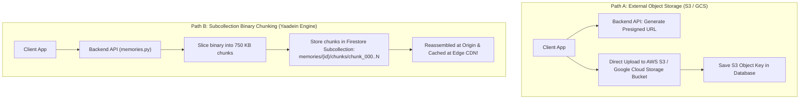

# Chapter 10: Bypassing DB Limits: Chunked Blobs vs. Object Storage

> *"When a tool gives you a hard limit, you have two choices: rewrite your entire infrastructure, or understand the data structures deeply enough to engineer around it."*

---

## 1. The Hard Database Ceiling

In software engineering, every database engine imposes physical limits on how much data can fit inside a single record:

| Database Engine | Maximum Document / Row Size | Error If Exceeded |
| :--- | :--- | :--- |
| **Amazon DynamoDB** | **400 Kilobytes** | `ValidationException: Item size has exceeded the maximum allowed size` |
| **Google Cloud Firestore** | **1,048,576 bytes (1 MiB)** | `InvalidArgument: Document exceeds maximum size limit of 1,048,576 bytes` |
| **MongoDB** | **16 Megabytes** | `BSONObjectTooLarge` |
| **PostgreSQL (standard row)** | **8 Kilobytes (TOAST off-row)** | Slow disk thrashing if unindexed |

In our club application, Firestore is the primary database. Notice the strict limit: **1 MiB (1,048,576 bytes)**.

If an alumnus uploads a 5.5 MB photo of the batch sitting on the Burla dam, and we attempt to save that image inside a Firestore document:

```python
await db.collection("memories").document("doc_101").set({
    "caption": "Burla Dam Reunion",
    "image_data": binary_bytes  # 5,500,000 bytes!
})
```

**The Google Cloud API throws an unrecoverable HTTP 400 error and crashes the upload.**

---

## 2. Object Storage vs. In-Database Chunking

When faced with this constraint, system designers evaluate two architectural paths:



### When to choose Path A (S3 / GCS Object Storage)?
- **Enterprise-scale applications** (e.g. YouTube, Dropbox, Airbnb) storing millions of files.
- Dedicated cloud infrastructure with IAM service accounts, bucket lifecycle policies, and multi-region bucket replication already provisioned.

### When to choose Path B (Subcollection Binary Chunking)?
- Self-contained web services where you want **zero extra cloud bucket dependencies** or permission headaches.
- Applications where you want **transactional atomicity**: deleting or managing the memory in the database guarantees that everything stays clean and self-contained.
- **Our Yaadein Architecture:** By engineering a chunking engine on top of Firestore, we enabled members to store up to **8 Megabytes of 4K imagery** natively within our existing database infrastructure!

Let us see how this engine works.

---

## 3. The 750 KB Binary Chunking Engine

In [`quiz-app/backend/routers/memories.py`](file:///Users/divyadarshee.das/Desktop/Pers/United89-club-app/quiz-app/backend/routers/memories.py), we defined three critical constants (lines 15–17):

```python
MAX_MASTER_DATA_URL_LENGTH = 11_000_000  # Supports up to ~8 MB binary High-Res Master
INLINE_DOC_THRESHOLD = 650_000           # Above ~480 KB binary, store in chunks
CHUNK_SIZE_BYTES = 750_000               # Safely under Firestore's 1,048,576 byte (1 MiB) limit
```

### Why 750 KB?
Why did we choose `750_000` bytes instead of `1,000,000`?
Because Firestore documents contain metadata: document keys, field names, timestamps, and BSON indexing overhead. Slicing at **750,000 bytes** provides a **25% safety margin**, ensuring that no chunk ever breaches Firestore's 1 MiB hard ceiling under any circumstances.

---

## 4. The Write Path: Slicing into Chunks

When an alumnus uploads a 5.5 MB photo, here is what happens inside `create_memory` (lines 232–271):

```python
# 1. Determine if this image exceeds our single-document inline threshold (~480 KB)
is_large_master = (
    payload.image_data_url.startswith("data:image/")
    and len(payload.image_data_url) > INLINE_DOC_THRESHOLD
)

# 2. Store the parent document (contains metadata + fast thumbnail)
doc_data = {
    "caption": payload.caption,
    "image_data_url": "" if is_large_master else payload.image_data_url,
    "thumb_data_url": payload.thumb_data_url,  # Fast 140 KB WebP is ALWAYS kept inline!
    "is_chunked": is_large_master,
    "mime_type": mime_type,
    "uploader_name": payload.uploader_name,
    "created_at": now_iso,
}
await doc_ref.set(doc_data)

# 3. If image is large, slice the binary bytes into a subcollection!
if is_large_master and b64_payload:
    binary_bytes = base64.b64decode(b64_payload)
    for idx, offset in enumerate(range(0, len(binary_bytes), CHUNK_SIZE_BYTES)):
        chunk_slice = binary_bytes[offset : offset + CHUNK_SIZE_BYTES]
        await doc_ref.collection("chunks").document(f"chunk_{idx:03d}").set(
            {"index": idx, "data": chunk_slice}
        )
```

### Visualizing the Database Layout:
```
Firestore Root:
└── memories /
    └── doc_9841af (Parent Document: ~150 KB)
        ├── caption: "Burla Reunion 2024"
        ├── is_chunked: true
        ├── thumb_data_url: "data:image/webp;base64,..." (~140 KB)
        │
        └── chunks / (Subcollection: Holds the 5.5 MB Master)
            ├── chunk_000: { index: 0, data: <750,000 binary bytes> }
            ├── chunk_001: { index: 1, data: <750,000 binary bytes> }
            ├── chunk_002: { index: 2, data: <750,000 binary bytes> }
            ├── chunk_003: { index: 3, data: <750,000 binary bytes> }
            ├── ...
            └── chunk_007: { index: 7, data: <250,000 binary bytes> }
```

Every chunk is indexed and named cleanly: `chunk_000`, `chunk_001`, `chunk_002`...  
None of them exceed 750 KB. Firestore accepts all writes happily!

---

## 5. The Read Path: Streaming & Reassembly

When an alumnus clicks the photo to view it in full-screen or download HD, the browser calls:
`GET /api/memories/doc_9841af/image`

Look at how `get_memory_image` in [`quiz-app/backend/routers/memories.py`](file:///Users/divyadarshee.das/Desktop/Pers/United89-club-app/quiz-app/backend/routers/memories.py) reassembles the pieces (lines 167–176):

```python
if data.get("is_chunked"):
    # 1. Query all chunks ordered strictly by their index (0, 1, 2, ...)
    chunk_docs = doc_ref.collection("chunks").order_by("index").stream()
    parts = []
    async for cdoc in chunk_docs:
        cdata = cdoc.to_dict() or {}
        blob = cdata.get("data")
        if blob:
            parts.append(bytes(blob))
    
    # 2. Seamlessly stitch the slices back into the original 5.5 MB binary file!
    binary_bytes = b"".join(parts)
```

---

## 6. The Edge Cache Synergy: Reassemble Once, Cache Forever!

A student might ask: *"Isn't querying 8 chunks from Firestore slower than querying 1 document?"*

Yes! Slicing and querying 8 subcollection documents takes about **80ms to 120ms** on the backend.

**However, look at what happens right after reassembly:**
Lines 184–201:
```python
etag = f'"{hashlib.sha256(binary_bytes).hexdigest()[:32]}"'
return Response(
    content=binary_bytes,
    media_type=mime_type,
    headers={
        "ETag": etag,
        "Cache-Control": "public, max-age=31536000, s-maxage=31536000, immutable",
    },
)
```

Because we return the reassembled 5.5 MB file with **`public, max-age=31536000, immutable`**:
1. The **Google Cloud CDN Edge PoP** intercepts the reassembled binary.
2. The Edge PoP saves the complete, unified 5.5 MB image into its high-speed NVMe SSD cache!
3. **The database reassembly only happens ONCE!**
4. Every other alumnus in the world who clicks "Download HD" receives the cached 5.5 MB binary directly from the Edge PoP in **15 milliseconds**!

```
Request 1 (Bhubaneswar):
Database reassembles 8 chunks (100ms) ──► Stored as 1 unified file in Edge CDN

Requests 2 to 1,000 (Global):
Edge CDN serves 1 unified file directly from cache (15ms)!
Database chunks are NEVER touched again!
```

---

## 7. Cleaning Up: The Cascade Delete Pattern

When an Admin deletes a photo in `delete_memory` (lines 339–344), what happens to those subcollection chunks?

In Firestore, deleting a parent document does **not** automatically delete its subcollections! If you don't delete the chunks, orphaned binary data will silently accumulate in your database.

Look at how our backend ensures clean garbage collection:

```python
# 1. Clean up binary chunks first
chunk_docs = doc_ref.collection("chunks").stream()
async for cdoc in chunk_docs:
    await cdoc.reference.delete()

# 2. Delete the parent metadata document
await doc_ref.delete()
```

---

## 8. Summary: Architectural Trade-Offs

| Architectural Approach | Pros | Cons | When to Use |
| :--- | :--- | :--- | :--- |
| **Object Storage (S3 / GCS)** | Infinite scale, low per-GB storage cost, native presigned URLs | Requires configuring separate cloud buckets, CORS policies, IAM service credentials | Apps storing millions of files with dedicated cloud infra |
| **Subcollection Chunking (Our Engine)** | 100% self-contained in DB, zero extra bucket setup, atomic transactional lifecycle | Slightly higher write latency on 1st upload, DB read ops on initial cache miss | Self-contained apps, club apps, or environments without S3/GCS buckets |

In the next chapter, we will inspect the frontend engine that prepares these images: **The Client-Side Image Processing Pipeline**.

---

### [$\leftarrow$ Previous: Chapter 09](file:///Users/divyadarshee.das/Desktop/Pers/United89-club-app/docs/cdn-system-design-course/09-the-5mb-to-7mb-high-res-problem-dual-tier-images.md) | [Next: Chapter 11 — Client-Side Image Pipeline $\to$](file:///Users/divyadarshee.das/Desktop/Pers/United89-club-app/docs/cdn-system-design-course/11-client-side-image-processing-pipeline.md)
