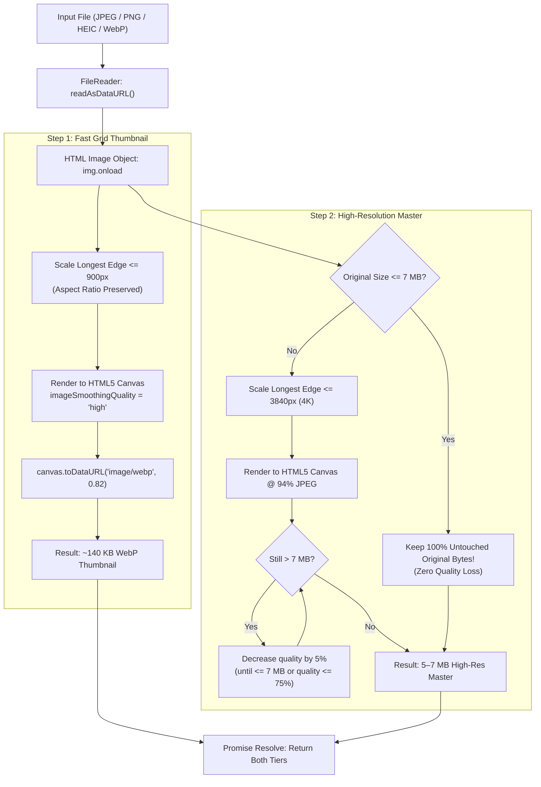

# Chapter 11: Client-Side Image Processing Pipeline

> *"The greenest, cheapest cloud compute is the compute that runs for free on the user's phone before a single packet is sent over the network."*

---

## 1. Why Process Images on the Client?

When engineers build an upload feature, the naive architecture is to let the user upload raw camera files directly to the server, and let the backend run ImageMagick or Pillow to resize them.

```
Naive Server-Side Pipeline:
User Phone (Flaky 4G) ──[ Uploads 25 MB Camera RAW (Takes 35s) ]──► Cloud Run Server
                                                                   │
                                           CPU Spikes to 100%! ────┘
                                           RAM Spikes to 512 MB!
                                           Cloud bill skyrockets!
```

### The 3 Server-Side Headaches:
1. **Network Ingress Pain:** Uploading 25 MB over a 4G uplink with packet loss takes 30 to 60 seconds and frequently times out on mobile networks.
2. **Server CPU Exhaustion:** Decoding and resizing 50 concurrent 25 MB images in Python or Go will consume all available CPU cores, slowing down API responses for everyone else.
3. **Cloud Billing:** You pay for the container CPU seconds spent crunching pixels!

### The Modern Alternative: In-Browser HTML5 Canvas Processing
Modern smartphones carry 6-core to 8-core CPUs and dedicated neural/GPU accelerators. By running image compression **inside the user's browser before transmission**, we:
- Offload 100% of image rendering CPU work to the client's device.
- Reduce upload payloads from **25 MB down to ~150 KB + 5 MB**.
- Cut upload time from 35 seconds to **under 2 seconds**.

Let us examine the exact file that powers this in our repo: [`quiz-app/frontend/src/utils/imageCompressor.js`](file:///Users/divyadarshee.das/Desktop/Pers/United89-club-app/quiz-app/frontend/src/utils/imageCompressor.js).

---

## 2. Architecture of `imageCompressor.js`



---

## 3. Line-by-Line Code Walkthrough

Let us inspect the implementation in detail.

### 1. The Ceiling Constant & Byte Formatter (lines 18–25)

```javascript
const MAX_MASTER_BYTES = 7 * 1024 * 1024; // 7 MB target ceiling

export function formatBytes(bytes) {
    if (!bytes || bytes <= 0) return '0 KB';
    if (bytes < 1024) return `${bytes} B`;
    if (bytes < 1024 * 1024) return `${(bytes / 1024).toFixed(1)} KB`;
    return `${(bytes / (1024 * 1024)).toFixed(2)} MB`;
}
```

- We establish `MAX_MASTER_BYTES` as $7 \times 1,024 \times 1,024 = 7,340,032\text{ bytes}$ (7 MB).
- `formatBytes` gives the user immediate visual feedback in the upload modal (e.g. *"Photo size: 5.24 MB (Preserved original)"*).

---

### 2. The Core Canvas Renderer: `renderToDataUrl` (lines 27–53)

This helper function performs the aspect-ratio downsampling and canvas encoding:

```javascript
function renderToDataUrl(img, maxDim, mimeType, quality) {
    let { width, height } = img;
    
    // 1. Maintain perfect aspect ratio
    if (width > maxDim || height > maxDim) {
        if (width >= height) {
            height = Math.round((height * maxDim) / width);
            width = maxDim;
        } else {
            width = Math.round((width * maxDim) / height);
            height = maxDim;
        }
    }
```

#### The Aspect-Ratio Math
If an original photo is $4000 \times 3000$ pixels (landscape) and `maxDim = 900`:
- Since $\text{width} \ge \text{height}$, width becomes `900`.
- $\text{height} = \text{round}\left(\frac{3000 \times 900}{4000}\right) = \mathbf{675\text{ pixels}}$.
- The aspect ratio is strictly preserved; the image never looks stretched or squished!

```javascript
    // 2. Create offscreen HTML5 Canvas
    const canvas = document.createElement('canvas');
    canvas.width = width;
    canvas.height = height;
    const ctx = canvas.getContext('2d');
    
    // 3. Enable high-quality anti-aliasing bicubic interpolation
    ctx.imageSmoothingEnabled = true;
    ctx.imageSmoothingQuality = 'high';
    ctx.drawImage(img, 0, 0, width, height);

    // 4. Encode to target format (WebP or JPEG)
    let dataUrl = canvas.toDataURL(mimeType, quality);
    
    // 5. Automatic Fallback: If older Safari doesn't support WebP encoding, fallback to JPEG
    if (mimeType === 'image/webp' && !dataUrl.startsWith('data:image/webp')) {
        dataUrl = canvas.toDataURL('image/jpeg', quality);
    }
    
    // 6. Calculate binary byte size from Base64 length: (chars * 3) / 4
    const b64Len = dataUrl.split(',')[1]?.length || 0;
    const sizeBytes = Math.round((b64Len * 3) / 4);
    
    return { dataUrl, width, height, sizeBytes };
}
```

Notice step 6: How do we calculate the exact binary size of a Base64 string without decoding it?  
Because each Base64 character represents 6 bits, $\text{length} \times 6 / 8 = \mathbf{(\text{length} \times 3) / 4}$ bytes!

---

### 3. The Orchestration Function: `compressImageFile` (lines 55–118)

This is the main function exported to [Yaadein.jsx](file:///Users/divyadarshee.das/Desktop/Pers/United89-club-app/quiz-app/frontend/src/pages/Yaadein.jsx):

```javascript
export function compressImageFile(file, { maxMasterDimension = 3840, thumbDimension = 900 } = {}) {
    return new Promise((resolve, reject) => {
        if (!file || !file.type?.startsWith('image/')) {
            reject(new Error('Please select a valid image file.'));
            return;
        }

        const reader = new FileReader();
        reader.onload = (event) => {
            const rawDataUrl = event.target.result;
            const img = new Image();
            img.onload = () => {
                const originalSizeBytes = file.size;

                // 1. Generate Fast Grid Thumbnail (~120-180 KB) for smooth album browsing
                const thumb = renderToDataUrl(img, thumbDimension, 'image/webp', 0.82);

                // 2. Determine High-Resolution Master (up to 7 MB)
                let masterDataUrl = rawDataUrl;
                let masterWidth = img.width;
                let masterHeight = img.height;
                let masterSizeBytes = originalSizeBytes;

                // Only compress Master if original file exceeds 7 MB
                if (originalSizeBytes > MAX_MASTER_BYTES) {
                    let quality = 0.94;
                    let rendered = renderToDataUrl(img, maxMasterDimension, 'image/jpeg', quality);
                    
                    // Quality decay loop: Gently dial back quality until <= 7 MB
                    while (rendered.sizeBytes > MAX_MASTER_BYTES && quality > 0.75) {
                        quality -= 0.05;
                        rendered = renderToDataUrl(img, maxMasterDimension, 'image/jpeg', quality);
                    }
                    masterDataUrl = rendered.dataUrl;
                    masterWidth = rendered.width;
                    masterHeight = rendered.height;
                    masterSizeBytes = rendered.sizeBytes;
                }

                resolve({
                    dataUrl: masterDataUrl,
                    thumbDataUrl: thumb.dataUrl,
                    width: masterWidth,
                    height: masterHeight,
                    originalSizeBytes,
                    compressedSizeBytes: masterSizeBytes,
                    thumbSizeBytes: thumb.sizeBytes,
                    preservedOriginal: originalSizeBytes <= MAX_MASTER_BYTES,
                });
            };
            img.src = rawDataUrl;
        };
        reader.readAsDataURL(file);
    });
}
```

---

## 4. Key Design Highlights of the Pipeline

1. **Zero Quality Loss for Reasonable Files:** If an alumnus uploads a 4.5 MB photo, `originalSizeBytes <= MAX_MASTER_BYTES` evaluates to `true`. The code skips master re-encoding entirely! The original raw bytes from the camera are preserved with zero compression artifacts.
2. **Graceful Quality Decay Loop:** If an alumnus uploads a monstrous 24 MB RAW DSLR file, the `while` loop starts at a pristine 94% quality and steps down in gentle 5% increments (`0.94 -> 0.89 -> 0.84...`) until the file fits inside our 7 MB ceiling.
3. **WebP for Grid Speed:** The thumbnail uses modern WebP at 82% quality, which yields **30% smaller files than JPEG** at equivalent visual quality.

In the next chapter, we will inspect the receiving side of this pipeline on the server: **Backend CDN Endpoints Code Walkthrough**.

---

### [$\leftarrow$ Previous: Chapter 10](file:///Users/divyadarshee.das/Desktop/Pers/United89-club-app/docs/cdn-system-design-course/10-bypassing-database-limits-chunked-blobs-vs-object-storage.md) | [Next: Chapter 12 — Backend CDN Endpoints $\to$](file:///Users/divyadarshee.das/Desktop/Pers/United89-club-app/docs/cdn-system-design-course/12-backend-cdn-endpoints-code-walkthrough.md)
