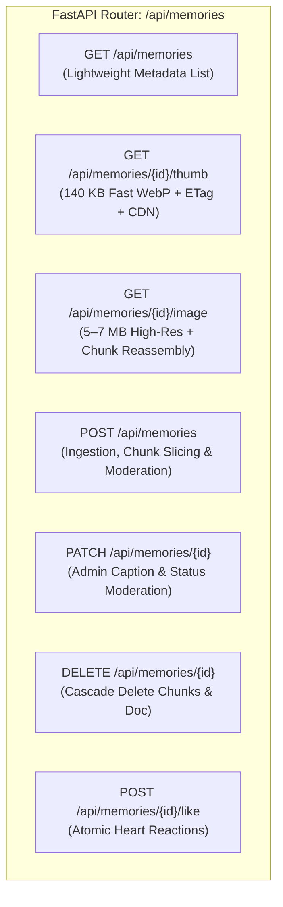

# Chapter 12: Backend CDN Endpoints Code Walkthrough

> *"A well-designed backend does not just serve bytes. It teaches every proxy, cache, and browser along the path how to never ask for those bytes again."*

---

## 1. High-Level Architecture of `memories.py`

In this chapter, we take a deep-dive tour through the heart of our media backend: [`quiz-app/backend/routers/memories.py`](file:///Users/divyadarshee.das/Desktop/Pers/United89-club-app/quiz-app/backend/routers/memories.py).

This single FastAPI router implements all the architectural principles we have studied so far:
1. **Lightweight Metadata Serialization** (keeping JSON lists small).
2. **Dual-Tier Media Endpoints** (`/thumb` for fast grids, `/image` for 4K masters).
3. **Subcollection Binary Chunking** (bypassing Firestore's 1 MiB limit).
4. **Conditional Revalidation** (`ETag` + `If-None-Match` $\implies$ `304 Not Modified`).
5. **Edge CDN Cache-Control Injection** (`public, max-age=31536000, s-maxage=31536000, immutable`).
6. **Role-Based Access Control (RBAC)** (admin moderation & visibility gating).



---

## 2. Line-by-Line Code Breakdown

---

### Part 1: Constants & Admin Identification (lines 14–29)

```python
ADMIN_PHONE = "9437555900"
MAX_MASTER_DATA_URL_LENGTH = 11_000_000  # Supports up to ~8 MB binary High-Res Master
INLINE_DOC_THRESHOLD = 650_000           # Above ~480 KB binary, store Master in 750 KB binary chunks
CHUNK_SIZE_BYTES = 750_000               # Safely under Firestore's 1,048,576 byte (1 MiB) doc limit

def _is_admin_user(current_user: Optional[dict], query_phone: Optional[str] = None) -> bool:
    if current_user:
        if current_user.get("role") == "admin":
            return True
        sub = normalize_phone(str(current_user.get("sub") or ""))
        if sub == ADMIN_PHONE:
            return True
    if query_phone and normalize_phone(query_phone) == ADMIN_PHONE:
        return True
    return False
```

- `MAX_MASTER_DATA_URL_LENGTH`: Protects our container memory against malicious users attempting to upload 50 MB payloads (enforces HTTP 413 Payload Too Large).
- `_is_admin_user`: Normalizes phone numbers (stripping leading zeros, `+91`, or spaces) to verify admin identity securely.

---

### Part 2: The Fast Thumbnail Endpoint (lines 107–147)

```python
@router.get("/{memory_id}/thumb")
async def get_memory_thumbnail(memory_id: str, request: Request):
    """
    Serves the fast ~150 KB Grid Thumbnail with 1-year immutable CDN Cache-Control.
    Falls back to the master image if no separate thumbnail exists.
    """
    if not db:
        raise HTTPException(status_code=503, detail="Database unavailable")

    # 1. Fetch document from Firestore
    doc = await db.collection("memories").document(memory_id).get()
    if not doc.exists:
        raise HTTPException(status_code=404, detail="Memory not found")

    data = doc.to_dict() or {}
    raw_data_url = data.get("thumb_data_url") or data.get("image_data_url") or ""
    if not raw_data_url.startswith("data:image/"):
        raise HTTPException(status_code=400, detail="Thumbnail unavailable")

    # 2. Extract MIME type & decode binary bytes
    header, b64_payload = raw_data_url.split(",", 1)
    mime_type = header.split(";")[0].replace("data:", "") or "image/webp"
    binary_bytes = base64.b64decode(b64_payload)

    # 3. Generate SHA-256 ETag fingerprint
    etag = f'"thumb-{hashlib.sha256(binary_bytes).hexdigest()[:28]}"'

    # 4. Check for conditional If-None-Match (304 revalidation)
    if request.headers.get("if-none-match") == etag:
        return Response(
            status_code=304,
            headers={
                "ETag": etag,
                "Cache-Control": "public, max-age=31536000, s-maxage=31536000, immutable",
            },
        )

    # 5. Full 200 OK delivery with CDN instructions
    return Response(
        content=binary_bytes,
        media_type=mime_type,
        headers={
            "ETag": etag,
            "Cache-Control": "public, max-age=31536000, s-maxage=31536000, immutable",
        },
    )
```

#### Why this is brilliant for CDNs:
- **`media_type=mime_type`:** Tells the browser and CDN whether the response is `image/webp` or `image/jpeg`.
- **`Cache-Control: ... s-maxage=31536000`:** Firebase Hosting and Google Cloud CDN will intercept this response on the first request and store it. Subsequent users never trigger this Python function!

---

### Part 3: The High-Res Master Endpoint with Chunk Reassembly (lines 149–202)

```python
@router.get("/{memory_id}/image")
async def get_memory_image(memory_id: str, request: Request):
    """
    Serves the High-Resolution Master image (up to 5–7 MB) with immutable CDN Cache-Control.
    If stored across Firestore binary chunks (`is_chunked = True`), reassembles chunks seamlessly.
    """
    if not db:
        raise HTTPException(status_code=503, detail="Database unavailable")

    doc_ref = db.collection("memories").document(memory_id)
    doc = await doc_ref.get()
    if not doc.exists:
        raise HTTPException(status_code=404, detail="Memory image not found")

    data = doc.to_dict() or {}
    mime_type = data.get("mime_type") or "image/jpeg"

    # CHUNK REASSEMBLY ENGINE:
    if data.get("is_chunked"):
        # Query chunks in ascending index order (0, 1, 2, ...)
        chunk_docs = doc_ref.collection("chunks").order_by("index").stream()
        parts = []
        async for cdoc in chunk_docs:
            cdata = cdoc.to_dict() or {}
            blob = cdata.get("data")
            if blob:
                parts.append(bytes(blob))
        # Concatenate bytes in memory
        binary_bytes = b"".join(parts)
    else:
        # Backward compatibility for smaller legacy images
        raw_data_url = data.get("image_data_url") or ""
        header, b64_payload = raw_data_url.split(",", 1)
        mime_type = header.split(";")[0].replace("data:", "") or "image/jpeg"
        binary_bytes = base64.b64decode(b64_payload)

    # Cryptographic ETag calculation on the reassembled master
    etag = f'"{hashlib.sha256(binary_bytes).hexdigest()[:32]}"'
    if request.headers.get("if-none-match") == etag:
        return Response(
            status_code=304,
            headers={
                "ETag": etag,
                "Cache-Control": "public, max-age=31536000, s-maxage=31536000, immutable",
            },
        )

    return Response(
        content=binary_bytes,
        media_type=mime_type,
        headers={
            "ETag": etag,
            "Cache-Control": "public, max-age=31536000, s-maxage=31536000, immutable",
        },
    )
```

---

### Part 4: Ingestion & Subcollection Slicing (lines 204–277)

When a photo is submitted via `POST /api/memories`:

```python
@router.post("")
async def create_memory(
    payload: MemoryCreateRequest,
    current_user: Optional[dict] = Depends(get_optional_current_user),
):
    # 1. Enforce payload size limit
    if len(payload.image_data_url) > MAX_MASTER_DATA_URL_LENGTH:
        raise HTTPException(status_code=413, detail="Image exceeds maximum allowed size (8 MB).")

    # 2. Moderation check: Admin uploads are auto-approved; regular members enter 'pending'
    uploader_phone = normalize_phone(str((current_user or {}).get("sub") or payload.uploader_phone or ""))
    is_admin = _is_admin_user(current_user, uploader_phone)
    initial_status = "approved" if is_admin else "pending"

    # 3. Determine if binary slicing is required
    is_large_master = (
        payload.image_data_url.startswith("data:image/")
        and len(payload.image_data_url) > INLINE_DOC_THRESHOLD
    )

    doc_data = {
        "caption": (payload.caption or "").strip(),
        "image_data_url": "" if is_large_master else payload.image_data_url,
        "thumb_data_url": payload.thumb_data_url,  # Fast thumbnail kept inline!
        "is_chunked": is_large_master,
        "status": initial_status,
        ...
    }
    await doc_ref.set(doc_data)

    # 4. Slice binary into 750 KB chunks if large
    if is_large_master and b64_payload:
        binary_bytes = base64.b64decode(b64_payload)
        for idx, offset in enumerate(range(0, len(binary_bytes), CHUNK_SIZE_BYTES)):
            chunk_slice = binary_bytes[offset : offset + CHUNK_SIZE_BYTES]
            await doc_ref.collection("chunks").document(f"chunk_{idx:03d}").set(
                {"index": idx, "data": chunk_slice}
            )
```

---

## 3. How Cloud Run + Firebase CDN Power This

Look at how all these pieces fit into the Google Cloud runtime:

```
[ User Browser ]
       │
       ▼
[ Firebase Hosting CDN Edge ]
       │ (Cache Miss)
       ▼
[ Cloud Run Container: asia-south2 (Delhi) ]
       │
       ▼
[ memories.py: get_memory_thumbnail() ]
       │
       ▼
[ Firestore: memories/{id} ]
```

1. **Auto-Scaling:** Cloud Run starts containers on demand. If traffic spikes during the reunion, Cloud Run automatically scales from 1 instance to 10 instances in seconds.
2. **CDN Offloading:** Because of the `Cache-Control: public, s-maxage=31536000` header returned by `memories.py`, **Google's Edge PoP absorbs 99% of requests**. Cloud Run only handles the initial ingestion and the very first cache miss!

In the next chapter, we will examine the security and moderation workflow: **Moderation State Machine and RBAC Security**.

---

### [$\leftarrow$ Previous: Chapter 11](file:///Users/divyadarshee.das/Desktop/Pers/United89-club-app/docs/cdn-system-design-course/11-client-side-image-processing-pipeline.md) | [Next: Chapter 13 — Moderation & RBAC Security $\to$](file:///Users/divyadarshee.das/Desktop/Pers/United89-club-app/docs/cdn-system-design-course/13-moderation-state-machine-and-rbac-security.md)
