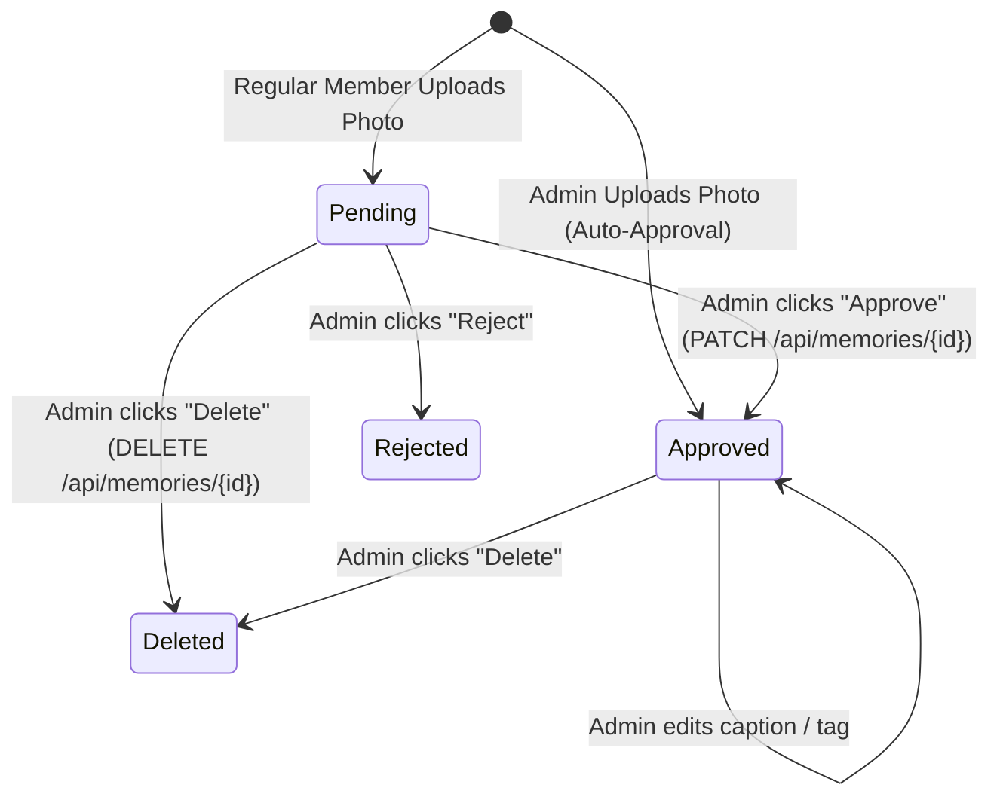

# Chapter 13: Moderation State Machine & RBAC Security

> *"In an open-upload community app, trust is your most valuable asset. If anyone can publish instantly without guardrails, a single accidental or spam upload can ruin the experience for everyone."*

---

## 1. Why Media Systems Require Moderation

When building an alumni or community platform like [Yaadein • यादें](file:///Users/divyadarshee.das/Desktop/Pers/United89-club-app/quiz-app/frontend/src/pages/Yaadein.jsx), members love contributing photos. However, completely unmoderated uploads create serious risks:
- **Accidental Uploads:** An alumnus accidentally selects a personal screenshot or invoice instead of a batch reunion photo.
- **Duplicate Uploads:** Two classmates upload the same group photo from different camera angles.
- **Inappropriate Content:** Bad actors or compromised accounts posting inappropriate media.
- **Incorrect Captions / Tags:** Misidentified batchmates or misspelled names.

At the same time, you cannot make the upload process hostile. If users upload a photo and it simply vanishes with no feedback, they will assume the app is broken and upload it five more times!

The solution is an **Asynchronous Moderation State Machine with Visibility Isolation**.

---

## 2. The Finite State Machine (FSM)

A Finite State Machine defines the valid states an object can occupy and the strict rules governing transitions between those states.



### The Three States:
1. **`pending`:** The photo is uploaded, compressed, and stored in the database, but **is NOT visible to the general public**. It is visible ONLY to the original uploader and the club Admin.
2. **`approved`:** The Admin has verified the photo. It is now published live for all club members to view, like, and share.
3. **`rejected` / `deleted`:** The photo is discarded and its binary chunks are permanently purged from database storage.

---

## 3. Visibility Isolation: The Uploader Feedback Loop

How do we give the uploader immediate feedback without exposing unapproved photos to everyone else?

In [`quiz-app/backend/routers/memories.py`](file:///Users/divyadarshee.das/Desktop/Pers/United89-club-app/quiz-app/backend/routers/memories.py), look at the filtering logic inside `list_memories` (lines 90–102):

```python
docs = db.collection("memories").stream()
items = []
async for doc in docs:
    data = doc.to_dict() or {}
    status = data.get("status", "pending")
    uploader_norm = normalize_phone(str(data.get("uploader_phone") or ""))

    # Never show rejected photos
    if status == "rejected":
        continue

    # TRIPLE VISIBILITY RULE:
    # 1. Admins see EVERYTHING (approved + pending)
    # 2. Regular users see all APPROVED photos
    # 3. Regular users see their OWN pending uploads!
    if is_admin or status == "approved" or (viewer_norm_phone and uploader_norm == viewer_norm_phone):
        items.append(_serialize_memory_doc(doc.id, data))
```

### The User Experience:
- When Debashis uploads a photo from his phone, he **immediately sees his photo at the top of the gallery**.
- His card displays a gentle amber badge:  
  `🕒 Pending Admin Approval (Visible to You)`
- Meanwhile, when his batchmate Sneha opens the app on her phone, **she does not see Debashis's photo yet**.
- Debashis feels confident that his upload worked, while Sneha's feed remains clean and curated!

---

## 4. Role-Based Access Control (RBAC) on the Backend

Security must **never** be enforced purely on the frontend. A malicious user can easily open curl or Postman and send HTTP requests directly to your backend API.

In `memories.py`, we enforce RBAC at the endpoint layer.

### 1. The Admin Verification Helper (lines 20–29)
```python
ADMIN_PHONE = "9437555900"

def _is_admin_user(current_user: Optional[dict], query_phone: Optional[str] = None) -> bool:
    if current_user:
        # Check JWT role claim
        if current_user.get("role") == "admin":
            return True
        # Check normalized JWT subject phone
        sub = normalize_phone(str(current_user.get("sub") or ""))
        if sub == ADMIN_PHONE:
            return True
    # Check normalized query parameter fallback
    if query_phone and normalize_phone(query_phone) == ADMIN_PHONE:
        return True
    return False
```

---

### 2. Protecting the Moderation Endpoint (lines 279–295)
Only the Admin is authorized to change the status or edit captions:

```python
@router.patch("/{memory_id}")
async def moderate_memory(
    memory_id: str,
    payload: MemoryModerateRequest,
    admin_phone: Optional[str] = Query(default=None),
    current_user: Optional[dict] = Depends(get_optional_current_user),
):
    if not _is_admin_user(current_user, admin_phone):
        raise HTTPException(
            status_code=403,
            detail="Only Admin can edit tags or moderate memories"
        )
```

If a regular member tries to forge a `PATCH` request, the server immediately denies it with **HTTP 403 Forbidden**.

---

### 3. Protecting the Delete Endpoint (lines 316–332)
Similarly, regular members cannot delete photos once submitted:

```python
@router.delete("/{memory_id}")
async def delete_memory(
    memory_id: str,
    user_phone: Optional[str] = Query(default=None),
    current_user: Optional[dict] = Depends(get_optional_current_user),
):
    if not _is_admin_user(current_user, requester_phone):
        raise HTTPException(
            status_code=403,
            detail="Only Admin can delete memories"
        )
```

---

## 5. Frontend Admin Controls in `Yaadein.jsx`

In [`quiz-app/frontend/src/pages/Yaadein.jsx`](file:///Users/divyadarshee.das/Desktop/Pers/United89-club-app/quiz-app/frontend/src/pages/Yaadein.jsx), the UI adapts based on the user's role:

### 1. The Admin Filter Bar (lines 463–488)
When the Admin logs in, a special tab bar appears at the top:
```jsx
{isAdmin && (
    <div className="flex items-center gap-2">
        <button onClick={() => setAdminFilter('all')}>All ({allMemories.length})</button>
        <button onClick={() => setAdminFilter('pending')}>
            <Clock size={13} />
            <span>Pending Approval ({pendingCount})</span>
        </button>
    </div>
)}
```
If there are pending photos awaiting review, the "Pending Approval" badge **pulses with an amber glow** to alert the Admin.

---

### 2. Quick One-Click Approval Card (lines 535–555)
Directly on the photo card, the Admin sees quick action buttons:
```jsx
{isAdmin && isPending && (
    <div className="flex items-center gap-1.5">
        <button onClick={(e) => handleAdminApprove(item, e)}>
            <Check size={12} /> Approve
        </button>
        <button onClick={(e) => handleDeleteItem(item, e)}>
            <Trash2 size={12} />
        </button>
    </div>
)}
```
Tapping **Approve** sends `PATCH /api/memories/{id}` with `status = 'approved'`, instantly publishing the photo to all members worldwide.

---

### 3. Lightbox Admin Tag & Caption Editor (lines 870–888)
If a caption has a typo or needs a better batch tag, the Admin can click **"Edit Tag"** inside the full-screen lightbox:
```jsx
{isAdmin && (
    <button onClick={() => setIsLightboxEditing(prev => !prev)}>
        <Edit3 size={13} />
        <span>Edit Tag</span>
    </button>
)}
```

---

## 6. Summary: Security Checklist for Media Applications

1. **Never trust the client:** Enforce all moderation and role checks on the backend server.
2. **Normalize identifiers:** Always normalize phone numbers and emails (`+91 943...` vs `943...`) before comparing with admin records.
3. **Isolate unmoderated content:** Prevent public CDN caching of unapproved items. Notice that only after approval do items appear in the public list API.
4. **Provide constructive feedback:** Allow uploaders to see their own pending items so they know their contribution was received safely.

In the next chapter, we will focus on frontend web performance: **Lazy Loading, Decoding Async, and Largest Contentful Paint (LCP)**.

---

### [$\leftarrow$ Previous: Chapter 12](file:///Users/divyadarshee.das/Desktop/Pers/United89-club-app/docs/cdn-system-design-course/12-backend-cdn-endpoints-code-walkthrough.md) | [Next: Chapter 14 — Frontend Performance & LCP $\to$](file:///Users/divyadarshee.das/Desktop/Pers/United89-club-app/docs/cdn-system-design-course/14-frontend-performance-lazy-loading-and-lcp.md)
