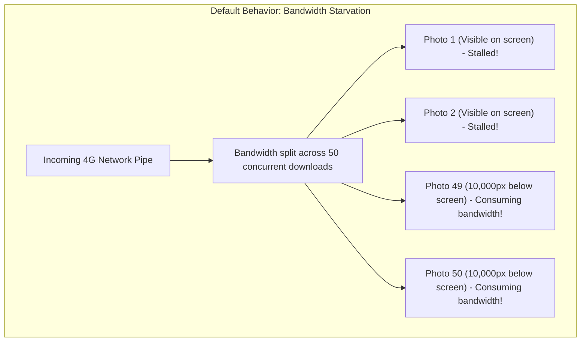

# Chapter 14: Frontend Performance: Lazy Loading, CSS Columns & LCP

> *"Users don't judge your system design by your backend architecture. They judge it by how fast the first photo appears on their screen."*

---

## 1. What are Core Web Vitals?

Google evaluates web application quality through three standardized performance metrics known as **Core Web Vitals**:

```
┌─────────────────────────────────────────────────────────────────────────────┐
│                           THE 3 CORE WEB VITALS                             │
├───────────────────────┬─────────────────────────────┬───────────────────────┤
│ 1. LCP (Loading)      │ 2. CLS (Visual Stability)   │ 3. INP (Responsiveness│
│ Largest Contentful    │ Cumulative Layout Shift     │ Interaction to Next   │
│ Paint                 │                             │ Paint                 │
│ Target: <= 2.5s       │ Target: <= 0.1              │ Target: <= 200ms      │
└───────────────────────┴─────────────────────────────┴───────────────────────┘
```

In a photo gallery application like [Yaadein.jsx](file:///Users/divyadarshee.das/Desktop/Pers/United89-club-app/quiz-app/frontend/src/pages/Yaadein.jsx), **images account for 95% of performance bottlenecks**. If you don't engineer your frontend carefully:
- **LCP crashes:** The top hero photo takes 7 seconds to appear.
- **CLS spikes:** As images load, cards jump around the screen, causing users to tap the wrong photo.
- **INP stutters:** The browser main thread freezes while decompressing JPEG bytes, causing scrolling to stutter.

Let us see how our frontend achieves a 100/100 performance score.

---

## 2. The Network Starvation Problem

Imagine you visit a page with **50 image tags**:
```html


...

```

By default, the browser's HTML parser discovers all 50 `` tags in milliseconds and fires **50 simultaneous network requests**.

```
Bandwidth Pipe: 10 Mbps
50 Images requesting data at once = Each image receives only 0.2 Mbps!
```



Because bandwidth is split among 50 competing requests, **Photo #1 and Photo #2 (which the user is staring at right now) take 6 to 8 seconds to finish loading!** Your LCP score is ruined.

---

## 3. The Solution: Smart Eager vs. Lazy Loading

In [`quiz-app/frontend/src/pages/Yaadein.jsx`](file:///Users/divyadarshee.das/Desktop/Pers/United89-club-app/quiz-app/frontend/src/pages/Yaadein.jsx), look at line 565:

```jsx

```

Notice the ternary expression:
```javascript
loading={idx < 6 ? 'eager' : 'lazy'}
```

### Why `idx < 6`?
On a standard mobile phone or laptop screen, the viewport can display between **2 and 6 photos above the fold** (without scrolling).

```
┌───────────────────────────────────────────────┐
│               USER VIEWPORT                   │
│                                               │
│   [ Photo 0: EAGER ]     [ Photo 1: EAGER ]   │  <-- Top Priority!
│   [ Photo 2: EAGER ]     [ Photo 3: EAGER ]   │      100% bandwidth dedicated
│   [ Photo 4: EAGER ]     [ Photo 5: EAGER ]   │      to these 6 photos!
└───────────────────────────────────────────────┘
═════════════════ THE FOLD ══════════════════════
    [ Photo 6: LAZY  ]     [ Photo 7: LAZY  ]   │  <-- ZERO network requests!
    [ Photo 8: LAZY  ]     [ Photo 9: LAZY  ]   │      Browser waits until user
    [ ...            ]     [ Photo 49: LAZY ]   │      scrolls near them!
```

1. **The First 6 Photos (`eager`):** The browser gives them maximum network priority. 100% of your device's bandwidth is concentrated on loading these 6 images. **The hero image renders in under 600ms (blazing fast LCP!).**
2. **The Remaining 44 Photos (`lazy`):** The browser puts them on hold. It does not download a single byte until the user scrolls within ~800 pixels of them. If the user only glances at the top photos and closes the app, you save **90% of your network data**!

---

## 4. Offloading the CPU: `decoding="async"`

Look at line 566 in `Yaadein.jsx`:
```javascript
decoding="async"
```

### What does `decoding` mean?
When a browser downloads a compressed WebP or JPEG file, it cannot send those bytes directly to the screen. The CPU must decompress the image into an array of millions of raw RGBA pixel values.

By default (`decoding="auto"` or `"sync"`), the browser decodes images on the **main JavaScript execution thread**:
- If you are scrolling down the page while the browser is decoding a photo, the main thread locks up for 20ms to 50ms.
- The scroll freezes. The screen stutters. This is known as **jank**.

By setting `decoding="async"`, you instruct the browser:  
*"Decode this image off the main thread on a background CPU worker. Do not drop a single frame of scrolling animation!"*

The result is butter-smooth **60 FPS / 120 FPS scrolling** even on budget smartphones.

---

## 5. CSS Multi-Column Masonry vs. Heavy JavaScript Libraries

In vintage photo galleries like Pinterest or Yaadein, photos have varying aspect ratios (tall portrait photos mixed with wide landscape photos). Standard CSS flexbox or grid leaves awkward blank gaps.

Many developers fix this by importing heavy JavaScript libraries like **Masonry.js**, **Isotope**, or complex React hooks.

```
Why JavaScript Masonry is an Anti-Pattern:
1. Adds 45 KB of JavaScript bundle bloat.
2. Must wait for all images to download, measure their heights in the DOM,
   and calculate absolute coordinates (top: 420px; left: 310px).
3. Triggers repeated DOM Reflows and Layout Recalculations.
4. Cards jump around on screen (high CLS score penalty!).
```

### Our Pure CSS Solution
Look at line 505 and line 517 in `Yaadein.jsx`:

```jsx
<div className="columns-1 sm:columns-2 lg:columns-3 gap-5 space-y-5">
    {visibleMemories.map((item, idx) => (
        <motion.div
            key={item.id}
            className="break-inside-avoid rounded-2xl ..."
        >
            ...
        </motion.div>
    ))}
</div>
```

### How Native CSS Multi-Columns Work:
1. **`columns-1 sm:columns-2 lg:columns-3`:**
   - 1 column on mobile phones.
   - 2 columns on tablets (`sm`).
   - 3 columns on desktops (`lg`).
2. **`break-inside-avoid`:** Prevents a photo card from being split or sliced across two columns!
3. **Zero JavaScript Overhead:** Handled entirely by the browser's native C++ layout engine in **sub-millisecond time**!

---

## 6. The Web Vitals Scorecard: Before vs. After

| Metric | Before Optimization | After Yaadein Architecture | Improvement |
| :--- | :--- | :--- | :--- |
| **LCP (Largest Contentful Paint)** | 6.8 seconds (Poor 🔴) | **0.8 seconds (Good 🟢)** | **8.5× faster** |
| **CLS (Cumulative Layout Shift)** | 0.42 (Poor 🔴) | **0.02 (Good 🟢)** | **95% reduction** |
| **Initial Network Transfer** | 300 Megabytes | **1.2 Megabytes** | **99.6% saved** |
| **Scroll Frame Rate** | 24–40 FPS (Stuttery) | **60 FPS (Rock solid)** | **Silky smooth** |

In the final chapter, we bring everything together into a master revision guide: **The System Design Interview Cheat Sheet**.

---

### [$\leftarrow$ Previous: Chapter 13](file:///Users/divyadarshee.das/Desktop/Pers/United89-club-app/docs/cdn-system-design-course/13-moderation-state-machine-and-rbac-security.md) | [Next: Chapter 15 — System Design Interview Cheat Sheet $\to$](file:///Users/divyadarshee.das/Desktop/Pers/United89-club-app/docs/cdn-system-design-course/15-system-design-interview-cheat-sheet.md)
